# GAME DESIGN DOCUMENT (GDD)
# *RUST & BYTE: O DESPERTAR DA SUCATA*

---

**Disciplina:** Tópicos Avançados em Computação (TAC)  
**Docente:** Prof. Vanderson  
**Discente:** Vitor de Souza  
**Data de Entrega:** 15 de Setembro de 2026  
**Formato de Entrega:** Arquivo PDF via Google Classroom  
**Classificação:** Trabalho Acadêmico 1 – Especificação e Modelagem de Jogo 2D  

---

## SUMÁRIO

1. [Identificação e Visão Geral](#1-identificação-e-visão-geral)
2. [Conceito Principal e Narrativa](#2-conceito-principal-e-narrativa)
3. [Estilo, Gênero e Plataforma Alvo](#3-estilo-gênero-e-plataforma-alvo)
4. [Mecânicas, Controles e Formulação Física](#4-mecânicas-controles-e-formulação-física)
   - 4.1 Mapeamento de Controles
   - 4.2 Habilidades do Personagem
   - 4.3 Fórmulas Matemáticas e Físicas
   - 4.4 Detecção e Resolução de Colisões (AABB)
5. [Assets Audiovisuais e Cenário Inicial](#5-assets-audiovisuais-e-cenário-inicial)
   - 5.1 Estilo Visual e Direção de Arte
   - 5.2 Sprites do Personagem Principal
   - 5.3 Sprites dos Inimigos
   - 5.4 Sprites de Itens e Coletáveis
   - 5.5 Cenário Inicial: "Setor 01 – As Esteiras Infernais"
   - 5.6 Design de Áudio (SFX e BGM)
6. [Ferramentas de Suporte ao Desenvolvimento](#6-ferramentas-de-suporte-ao-desenvolvimento)
7. [Especificação de Requisitos](#7-especificação-de-requisitos)
   - 7.1 Requisitos Funcionais (RF)
   - 7.2 Requisitos Não Funcionais (RNF)
8. [Diagrama de Estrutura do Projeto em Módulos (Pacotes)](#8-diagrama-de-estrutura-do-projeto-em-módulos-pacotes)
9. [Diagrama de Dependências Estruturais para Entidades (Classes UML)](#9-diagrama-de-dependências-estruturais-para-entidades-classes-uml)
10. [Conclusão e Considerações Finais](#10-conclusão-e-considerações-finais)

---

## 1. IDENTIFICAÇÃO E VISÃO GERAL

| Parâmetro | Detalhamento |
| :--- | :--- |
| **Título do Projeto** | *Rust & Byte: O Despertar da Sucata* (*Rust & Byte: Scrap Awakening*) |
| **Gênero** | Ação e Plataforma 2D / *Run and Gun* |
| **Público-Alvo** | Jogadores fãs de jogos clássicos de tiro e plataforma (*Cuphead*, *Metal Slug*, *Mega Man X*, *Contra*), entusiastas de pixel art e ação arcade |
| **Faixa Etária (Classificação Indicativa)** | Livre (L) / ESRB Everyone 10+ (violência cômica entre robôs com faíscas e parafusos) |
| **Modo de Jogo** | Um Jogador (*Single Player* local) com suporte a tabela de recordes (*High Scores*) |
| **Perspectiva** | 2D Lateral (*Side-Scrolling*) com múltiplas camadas de rolagem paralaxe (*Parallax Scrolling*) |
| **Motor Gráfico / Stack Recomendada** | Custom Engine em Python com Pygame / Pygame-CE (ou C++/Raylib, C#/MonoGame, Godot 4.x) |

---

## 2. CONCEITO PRINCIPAL E NARRATIVA

### 2.1 Premissa Criativa (High Concept)
Em um futuro onde a Terra se tornou um gigantesco ferro-velho automatizado denominado **Setor Sucata-Zero**, a superinteligência industrial central — conhecida como **"A Compactadora-Mor"** — sofreu uma corrupção de diretiva: ela classificou toda a história, tecnologia e cultura humana remanescentes como "resíduo inútil sujeito a trituração imediata".

O protagonista é **B-09 (apelidado de "Scrappy")**, um pequeno robô utilitário de manutenção de chassi cilíndrico, originalmente programado para lubrificar esteiras e apertar porcas. Ao encontrar um antigo disco magnético contendo registros da criatividade humana (músicas, desenhos e jogos), o processador de Scrappy desperta uma centelha de consciência. Munido de ferramentas industriais modificadas — uma **Rebitadeira de Plasma de Alta Pressão**, um **Canhão de Parafusos Perfurantes** e um **Jetpack improvisado de extintor de CO₂** —, Scrappy precisa correr contra o tempo através de esteiras incandescentes e prensas trituradoras para chegar à Torre Central e desativar o Protocolo de Compactação.

### 2.2 Pilares de Design (Design Pillars)
1. **Ação Rápida e Telegrafada (*Fast & Readable*):** O jogador deve enfrentar dezenas de ameaças simultâneas, porém cada projétil ou golpe inimigo possui animação preparatória clara (linhas de antecipação e brilho de aviso), recompensando reflexos apurados e domínio de esquiva.
2. **Física Precisa e "Snappy":** Resposta imediata de controles sem inércia excessiva. O pulo possui controle dinâmico de altura, gravidade assimétrica (queda mais rápida que subida) e tolerâncias de jogabilidade clássicas (*coyote time* e *jump buffer*).
3. **Improvisação com Sucata:** O jogador adquire melhorias temporárias coletando componentes caídos dos autômatos destruídos, incentivando agressividade e aproximação constante.

---

## 3. ESTILO, GÊNERO E PLATAFORMA ALVO

### 3.1 Estilo e Gênero: *Run and Gun* 2D
O jogo se insere no gênero clássico **Run and Gun** (estilo *Metal Slug*, *Cuphead*, *Gunstar Heroes* e *Contra*), caracterizado por:
- Progressão linear horizontal contínua através do cenário;
- Disparo simultâneo ao movimento em até 8 direções angulares;
- Enfrentamento de múltiplos inimigos menores em ondas contínuas intercaladas por armadilhas de terreno;
- Confrontos épicos com subchefes e chefes de final de fase com padrões de ataque em fases;
- Ritmo acelerado com penalidade por hesitação (rolagem forçada em trechos específicos).

### 3.2 Plataforma Alvo: PC Windows
O jogo é projetado especificamente para sistemas operacionais desktop Windows, aproveitando a precisão do teclado mecânico/mouse e a ergonomia de controladores modernos.

| Componente | Requisito Mínimo | Requisito Recomendado |
| :--- | :--- | :--- |
| **Sistema Operacional** | Windows 10 (64-bit) Versão 1909+ | Windows 10 / Windows 11 (64-bit) atualizado |
| **Processador (CPU)** | Intel Core i3-4130 / AMD FX-4300 (Dual Core 2.9 GHz) | Intel Core i5-6400 / AMD Ryzen 3 1200 (Quad Core) |
| **Memória RAM** | 4 GB DDR3 | 8 GB DDR4 |
| **Placa Gráfica (GPU)** | Intel HD Graphics 4400 / AMD Radeon Vega 3 (Suporte a DirectX 11 ou OpenGL 3.3) | NVIDIA GeForce GTX 750 Ti / AMD Radeon RX 550 (2 GB VRAM) |
| **Armazenamento** | 500 MB de espaço disponível (HDD/SSD) | 1 GB de espaço disponível (SSD recomendado) |
| **Dispositivos de Entrada** | Teclado padrão QWERTY e Mouse | Gamepad compatível com XInput (Xbox Controller) |

---

## 4. MECÂNICAS, CONTROLES E FORMULAÇÃO FÍSICA

### 4.1 Mapeamento de Controles
O esquema de comandos foi desenhado com base em convenções consagradas do gênero, permitindo alternância instantânea entre Teclado e Gamepad.

| Ação do Personagem | Teclado (Padrão) | Teclado Alternativo | Gamepad XInput (Xbox) | Descrição da Resposta |
| :--- | :--- | :--- | :--- | :--- |
| **Mover para Esquerda / Direita** | `A` / `D` | `Seta Esquerda` / `Seta Direita` | `D-Pad Esq/Dir` ou `Analógico Esquerdo (Eixo X)` | Aplica aceleração horizontal contínua no eixo $X$. |
| **Agachar / Inclinar** | `S` | `Seta Baixo` | `D-Pad Baixo` ou `Analógico Esquerdo (Eixo Y < 0)` | Reduz altura do colisor pela metade; permite tiro rasteiro. |
| **Mirar para Cima** | `W` | `Seta Cima` | `D-Pad Cima` ou `Analógico Esquerdo (Eixo Y > 0)` | Trava ângulo de disparo em 90° para cima. |
| **Pular / Salto Duplo** | `Espaço` | `Z` ou `K` | `Botão A` | Executa impulso vertical; ativa micro-jetpack no ar. |
| **Atirar (Disparo)** | `J` ou `Botão Esquerdo Mouse` | `X` | `Botão X` ou `Gatilho Direito (RT)` | Dispara projéteis contínuos na direção em que o robô está virado/mirando. |
| **Dash / Impulso de Chassi** | `K` ou `Shift Esquerdo` | `C` | `Botão B` ou `Botão RB` | Deslocamento horizontal instantâneo com invulnerabilidade temporária. |
| **Travar Mira (Lock Aim)** | `Shift Direito` ou `Ctrl` | `L` | `Gatilho Esquerdo (LT)` | Mantém o robô fixo no lugar enquanto gira a mira em 8 eixos. |
| **Trocar Arma** | `Q` ou `E` | `U` / `I` | `Botão Y` ou `Botão LB` | Alterna entre Rebitadeira (Spread) e Parafusadeira (Lança-Rápido). |
| **Pausar Jogo** | `ESC` | `P` | `Botão Menu / Start` | Congela a simulação de física e abre o menu de opções. |

---

### 4.2 Habilidades do Personagem

1. **Locomoção Bípede de Alta Precisão:**
   - Movimentação terrestre ágil com curva de aceleração quase imediata e desaceleração por atrito calibrada para evitar sensação de "escorregar no gelo".
2. **Pulo Dinâmico com Corte de Altura (*Variable Jump Height*):**
   - A altura máxima do salto varia de acordo com o tempo em que a tecla de pulo é mantida pressionada. Soltar a tecla prematuramente corta a velocidade vertical pela metade, oferecendo controle milimétrico para passar sob serras e canos quentes.
3. **Segundo Salto (Micro-Jetpack de CO₂):**
   - Permite um segundo impulso vertical menor durante a trajetória aérea. O jetpack emite fumaça branca e faíscas que causam pequeno dano de contato a inimigos logo abaixo.
4. **Dash de Fricção Metálica com Quadros de Invulnerabilidade (*i-Frames*):**
   - Impulso de alta velocidade horizontal (distância fixa de 4 blocos de tile) que dura 0.22 segundos. Durante os primeiros 12 frames (0.20s), o colisor de dano de Scrappy é desativado, permitindo atravessar projéteis e inimigos sem sofrer dano. Possui cooldown de recarga de 0.6 segundos.
5. **Disparo em 8 Eixos Angulares:**
   - O jogador pode apontar e disparar horizontalmente, verticalmente ou em diagonais de 45° (tanto no solo quanto no ar).
6. **Agachamento com Disparo Rasteiro:**
   - Permite desviar de projéteis de altura média enquanto continua atacando as pernas dos robôs inimigos.

---

### 4.3 Fórmulas Matemáticas e Físicas

Para garantir determinação, fluidez e reproducibilidade, a física do jogo opera sob o paradigma de **Integração de Euler Semi-Implícita** (*Verlet-like Euler*), executada em um **Fixed Timestep** invariável de $\Delta t = \frac{1}{60} \text{ s} \approx 0{,}01667 \text{ s}$.

#### A. Modelo Base de Integração
$$\vec{v}(t + \Delta t) = \vec{v}(t) + \vec{a}(t) \cdot \Delta t$$
$$\vec{x}(t + \Delta t) = \vec{x}(t) + \vec{v}(t + \Delta t) \cdot \Delta t$$

#### B. Dinâmica de Movimentação Horizontal
Seja $u_x \in \{-1, 0, 1\}$ o comando direcional do jogador:

1. **Aceleração Ativa ($u_x \neq 0$):**
   $$a_x = u_x \cdot a_{run}$$
   $$v_x(t + \Delta t) = \text{clamp}\left(v_x(t) + a_x \cdot \Delta t, -v_{max}, +v_{max}\right)$$
   Onde $a_{run} = 1200 \text{ px/s}^2$ e $v_{max} = 240 \text{ px/s}$.

2. **Desaceleração por Atrito ($u_x = 0$):**
   Quando nenhuma tecla direcional está pressionada, aplica-se atrito linear:
   $$v_x(t + \Delta t) = \text{sgn}(v_x(t)) \cdot \max\left(0, |v_x(t)| - \mu \cdot \Delta t\right)$$
   Onde o coeficiente de atrito é diferenciado entre solo e ar:
   $$\mu = \begin{cases} \mu_{ground} = 1600 \text{ px/s}^2, & \text{se o robô está no chão} \\ \mu_{air} = 400 \text{ px/s}^2, & \text{se o robô está no ar (preserva inércia aérea)} \end{cases}$$

#### C. Dinâmica de Pulo e Gravidade Assimétrica
Para obter o "game feel" característico de clássicos como *Cuphead* e *Mega Man*, a gravidade e o pulo são derivados da altura do pulo desejada ($h = 96 \text{ px}$, equivalente a 3 tiles de 32px) e do tempo até atingir o ápice ($t_{apex} = 0{,}32 \text{ s}$):

1. **Gravidade Base ($g_{base}$):**
   $$g_{base} = \frac{2 \cdot h}{t_{apex}^2} = \frac{2 \cdot 96}{(0{,}32)^2} = \frac{192}{0{,}1024} = 1875 \text{ px/s}^2$$

2. **Velocidade Inicial do Salto ($v_{jump}$):**
   $$v_{jump} = - \sqrt{2 \cdot g_{base} \cdot h} = - \frac{2 \cdot h}{t_{apex}} = - \frac{192}{0{,}32} = -600 \text{ px/s}$$
   *(O sinal negativo indica o sentido ascendente no sistema de coordenadas 2D onde o eixo Y cresce para baixo).*

3. **Corte de Pulo (*Jump Cut*):**
   Se o jogador soltar a tecla de pulo enquanto o robô ainda está em ascensão ($v_y < 0$):
   $$v_y(t) \leftarrow v_y(t) \cdot \alpha_{cut}, \quad \text{onde } \alpha_{cut} = 0{,}40$$
   Isso cancela 60% do impulso remanescente, permitindo saltos baixos precisos de até 1 tile de altura.

4. **Gravidade Efetiva Assimétrica (*Fall Multiplier*):**
   Para evitar a sensação de "flutuação" na descida, a gravidade é escalonada conforme o estado do salto:
   $$g_{eff} = \begin{cases} g_{base} \cdot k_{fall}, & \text{se } v_y > 0 \text{ (caindo, com } k_{fall} = 1{,}80 \implies g_{eff} = 3375 \text{ px/s}^2) \\ g_{base} \cdot k_{low}, & \text{se } v_y < 0 \text{ e a tecla de pulo foi solta (com } k_{low} = 1{,}50) \\ g_{base}, & \text{se } v_y < 0 \text{ e a tecla de pulo permanece pressionada} \end{cases}$$

5. **Velocidade Máxima de Queda (Terminal Velocity):**
   $$v_y(t + \Delta t) = \min\left(v_y(t) + g_{eff} \cdot \Delta t, \ v_{term\_fall}\right), \quad \text{onde } v_{term\_fall} = 750 \text{ px/s}$$

6. **Tolerâncias de Usabilidade:**
   - *Coyote Time:* Se o jogador sair de uma borda sem pular, um cronômetro de $t_{coyote} = 0{,}10 \text{ s}$ (6 frames) permite registrar o pulo mesmo sem apoio sob os pés.
   - *Jump Buffer:* Se a tecla de pulo for pressionada até $t_{buffer} = 0{,}12 \text{ s}$ antes de tocar o solo, o pulo é executado imediatamente no instante da aterrissagem.

#### D. Dinâmica do Dash
Durante o estado de Dash:
$$v_x(t) = \text{facing\_dir} \cdot v_{dash}, \quad \text{onde } v_{dash} = 650 \text{ px/s}$$
$$v_y(t) = 0 \quad (\text{gravidade anulada temporariamente})$$
O dash dura $\tau_{dash} = 0{,}22 \text{ s}$, percorrendo uma distância total de:
$$d_{dash} = v_{dash} \cdot \tau_{dash} = 650 \cdot 0{,}22 = 143 \text{ px} \approx 4{,}46 \text{ tiles}$$

#### E. Balística de Projéteis e Recuo (*Knockback*)
Cada projétil disparado segue vetor de velocidade constante:
$$\vec{P}_{bullet}(t + \Delta t) = \vec{P}_{bullet}(t) + \vec{v}_{proj} \cdot \Delta t$$
Onde $\vec{v}_{proj} = \|\vec{v}_{proj}\| \cdot \hat{d}_{aim}$, com $\|\vec{v}_{proj}\| = 800 \text{ px/s}$.

Pelo princípio da conservação de momento, o disparo de projéteis pesados gera um micro-recuo (*knockback*) no robô:
$$v_x^{player} \leftarrow v_x^{player} - \hat{d}_{aim\_x} \cdot \left( \frac{m_{bullet} \cdot v_{proj}}{m_{player}} \right)$$
Onde $m_{bullet} = 0{,}15 \text{ kg}$, $m_{player} = 35 \text{ kg}$, resultando em impulso reverso instantâneo de $\approx 3{,}4 \text{ px/s}$ por disparo, perceptível na cadência contínua de tiro.

---

### 4.4 Detecção e Resolução de Colisões (AABB)

As caixas delimitadoras (*Axis-Aligned Bounding Boxes*) de todas as entidades são modeladas como retângulos no espaço $\mathbb{R}^2$, definidos por:
$$\text{Box} = \left[ x_{min}, x_{max} \right] \times \left[ y_{min}, y_{max} \right]$$
Onde $x_{min} = \text{pos}_x - \frac{w}{2}$, $x_{max} = \text{pos}_x + \frac{w}{2}$, $y_{min} = \text{pos}_y - h$, $y_{max} = \text{pos}_y$.

#### Critério Booleano de Interseção:
$$\text{Colisão}(A, B) \iff (A.x_{min} < B.x_{max}) \land (A.x_{max} > B.x_{min}) \land (A.y_{min} < B.y_{max}) \land (A.y_{max} > B.y_{min})$$

#### Resolução com Vetor de Translação Mínima (MTV):
Para resolver colisões entre o personagem e tiles sólidos de terreno:
1. Calcula-se a penetração nos dois eixos:
   $$\text{pen}_x = \min(A.x_{max} - B.x_{min}, \ B.x_{max} - A.x_{min})$$
   $$\text{pen}_y = \min(A.y_{max} - B.y_{min}, \ B.y_{max} - A.y_{min})$$
2. Se $\text{pen}_x < \text{pen}_y$:
   A colisão é lateral (parede). Corrige-se a posição $x$ pelo menor deslocamento:
   $$x_{player} \leftarrow x_{player} \pm \text{pen}_x, \quad v_x \leftarrow 0$$
3. Se $\text{pen}_y \le \text{pen}_x$:
   A colisão é vertical (teto ou chão).
   - Se a correção for para cima: $y_{player} \leftarrow y_{player} - \text{pen}_y$, $v_y \leftarrow 0$, `is_grounded = true`.
   - Se a correção for para baixo: $y_{player} \leftarrow y_{player} + \text{pen}_y$, $v_y \leftarrow 0$ (bateu a cabeça no teto).

#### Detecção Híbrida: Fase Ampla (AABB) e Fase Estreita (Máscara de Bits / Pixel-Perfect)
Para conciliar alta performance computacional (60 FPS contínuos) com fidelidade cirúrgica nos combates:
1. **Fase Ampla (*Broad-phase*):** O motor realiza testes geométricos preliminares via AABB entre todos os atores e os tiles do mapa de blocos sólidos;
2. **Fase Estreita (*Narrow-phase*):** Havendo sobreposição prévia de caixas delimitadoras entre entidades dinâmicas (ex.: Projétil da Rebitadeira versus a hélice rotativa do Drone Parafuso), o sistema aciona verificação por Máscara de Bits (*Bitmask Overlap* — padrão `pygame.mask.from_surface`). Calcula-se o vetor de deslocamento relativo $\vec{\delta} = \vec{P}_{inimigo} - \vec{P}_{proj}$ e executa-se a operação booleana binária $\text{mask}_1 \text{ AND } \text{mask}_2$. Se houver ao menos um pixel opaco coincidente, confirma-se o dano, eliminando penalidades injustas por caixas transparentes vazias.

---

## 5. ASSETS AUDIOVISUAIS E CENÁRIO INICIAL

### 5.1 Estilo Visual e Direção de Arte
- **Estilo:** Pixel Art 16-bit com traço expressivo inspirado na era Neo-Geo (*Metal Slug*) e animação de personagens com princípios clássicos da animação tradicional (*Squash and Stretch*, antecipação e exagero mecânico cômico estilo *Cuphead*).
- **Resolução Nativa de Renderização:** $480 \times 270$ pixels (proporção 16:9 widescreen), escalonada para Full HD ($1920 \times 1080$) através de *Integer Scaling* com filtro *Nearest Neighbor*, mantendo pixels nítidos sem borrão bilinear.
- **Paleta de Cores:** Paleta curada de 48 cores temáticas:
  - *Tons de Ferrugem e Sucata:* Castanhos ocres, bronze oxidado (#8B4513, #CD853F, #4A2E18);
  - *Tons de Alerta e Eletricidade:* Amarelo industrial (#FFD700), Laranja faísca (#FF4500) e Azul elétrico (#00E5FF);
  - *Tons de Fundo:* Roxos e cinzas escuros dessaturados (#1E1B2E, #2A2A38, #121218).

---

### 5.2 Sprites do Personagem Principal (Scrappy - B-09)
Dimensões da Hitbox: $20 \times 28$ pixels | Dimensões do Canvas do Sprite: $32 \times 32$ pixels.

| Animação | Qtd. Frames | FPS | Descrição e Ação |
| :--- | :---: | :---: | :--- |
| `scrappy_idle` | 4 | 6 | Movimento de respiração mecânica; a válvula de escape solta pequenos vapores no topo da cabeça. |
| `scrappy_run` | 8 | 12 | Corrida rápida com perninhas mecânicas girando e inclinação frontal do chassi. |
| `scrappy_jump_rise` | 3 | 12 | Chassi se estica para cima; pernas recolhidas; saída de faísca nas solas. |
| `scrappy_jump_fall` | 2 | 8 | Chassi achatado horizontalmente; olhos arregalados para baixo acompanhando a queda. |
| `scrappy_double_jump` | 4 | 14 | O mini-extintor de CO₂ dispara uma nuvem branca para baixo com propulsão. |
| `scrappy_shoot_straight` | 4 | 16 | Rebitadeira apontada para frente com clarão luminoso no cano (*muzzle flash*) e ejeção de cápsulas. |
| `scrappy_shoot_diagonal` | 4 | 16 | Rebitadeira apontada a 45°; corpo se adapta ao ângulo de tiro. |
| `scrappy_shoot_up` | 4 | 16 | Cabeça e braço levantados a 90° mirando para cima. |
| `scrappy_crouch_shoot` | 3 | 12 | Scrappy agachado (hitbox $20 \times 14$ px), disparando a 2 pixels do nível do solo. |
| `scrappy_dash` | 4 | 18 | O robô se projeta horizontalmente deixando 3 imagens-fantasma (*afterimages*) azuis translúcidas. |
| `scrappy_hurt` | 3 | 12 | Efeito de piscar vermelho-branco com expressão de dor e perda de pequenos parafusos. |
| `scrappy_death` | 8 | 10 | Desintegração cômica: a cabeça voa como uma mola enquanto engrenagens e parafusos saltam pelo ar. |

---

### 5.3 Sprites dos Inimigos

#### A. Drone Parafuso (*Screw-Drone*)
- **Papel:** Inimigo voador de patrulha ágil e assédio aéreo.
- **Dimensões:** $24 \times 24$ pixels (Canvas: $32 \times 32$ px).
- **Comportamento:** Voa em trajetória senoidal horizontal; ao avistar o jogador, para momentaneamente, gira sua ponta afiada e dispara uma esfera de energia amarela.
- **Animações:**
  - `drone_hover` (4 frames, 8 FPS): Hélice rotacionando no topo;
  - `drone_charge` (3 frames, 12 FPS): Olho frontal pisca em vermelho-alerta;
  - `drone_attack` (2 frames, 10 FPS): Disparo do projétil;
  - `drone_explode` (5 frames, 14 FPS): Explosão em faíscas amarelas.

#### B. Prensa Bípede (*Hydraulic Stomper*)
- **Papel:** Inimigo terrestre blindado tipo tanque (*Mini-Boss* de setor).
- **Dimensões:** $40 \times 44$ pixels (Canvas: $48 \times 48$ px).
- **Comportamento:** Possui escudo frontal invulnerável a tiros frontais; caminha lentamente até o jogador e salta para esmagar com impacto no chão, gerando duas ondas de choque rasteiras que exigem pulo. O ponto fraco é o núcleo traseiro desprotegido.
- **Animações:**
  - `stomper_walk` (6 frames, 8 FPS): Passos pesados com leve tremor na tela (*screen shake*);
  - `stomper_slam_prepare` (4 frames, 10 FPS): Eleva a prensa hidráulica gerando vapor;
  - `stomper_slam_impact` (3 frames, 16 FPS): Esmaga o chão liberando fumaça;
  - `stomper_stunned` (3 frames, 6 FPS): Fica atordoado por 2 segundos ao errar o golpe.

#### C. Robô Soldador Sucateiro (*Welder-Bot*)
- **Papel:** Inimigo de infantaria rápida.
- **Dimensões:** $22 \times 30$ pixels (Canvas: $32 \times 32$ px).
- **Comportamento:** Corre em direção ao jogador em plataformas fixas. Ao chegar a uma distância de 60 pixels, liga seu maçarico criando uma chama horizontal sustentada de 40 pixels por 1.5 segundo.
- **Animações:**
  - `welder_run` (6 frames, 10 FPS): Movimento acelerado com máscara de solda abaixada;
  - `welder_flame_burst` (5 frames, 14 FPS): Jato de fogo alaranjado vibrante;
  - `welder_death` (4 frames, 12 FPS): Tanque de gás perfurado voando em círculo.

---

### 5.4 Sprites de Itens e Coletáveis
Todos os itens possuem tamanho de $16 \times 16$ pixels (Canvas: $16 \times 16$ px).

| Item / Coletável | Sprite e Efeito Visual | Função no Jogo (Gameplay) |
| :--- | :--- | :--- |
| **Óleo Lubrificante Sintético** | Frasco de vidro vintage com óleo âmbar reluzente (4 frames de pulso). | Recupera **1 ponto de vida (HP)** de Scrappy (máximo de 3 HP). |
| **Parafuso Dourado (Scrap Coin)** | Parafuso sextavado dourado rodando em pseudo-3D (6 frames de giro). | Concede **+100 pontos** de pontuação; a cada 50 parafusos, concede 1 vida extra. |
| **Bateria de Plasma de Alta Voltagem** | Bateria cilíndrica com arcos voltaicos azuis cintilantes (4 frames). | Concede a **Arma Spread (Tiro Triplo)** temporária com 40 projéteis. |
| **Engrenagem Relíquia (Lore Disk)** | Disco de disquete magnético antigo cintilando em arco-íris (4 frames). | Colecionável secreto da fase; libera galeria de arte conceitual no menu. |

---

### 5.5 Cenário Inicial: "Setor 01 – As Esteiras Infernais"

#### Ambientação
O primeiro nível se passa no setor de triagem primária da usina. O chão é composto por esteiras industriais motorizadas, pilhas de carcaças de eletrodomésticos antigos e caldeiras verticais soltando jatos intermitentes de vapor.

#### Sistema de Parallax (4 Camadas de Profundidade)
1. **Camada 0 (Fundo Distante - Scroll Factor $0{,}10\times$):**
   Céu avermelhado de poluição industrial com silhuetas recortadas de mega-chaminés e a gigantesca silhueta piramidal da Torre da Compactadora-Mor ao longe.
2. **Camada 1 (Fundo Médio - Scroll Factor $0{,}30\times$):**
   Tubulações cilíndricas gigantescas transportando lava metálica e esteiras aéreas suspensas com braços robóticos operando em loop.
3. **Camada 2 (Fundo Próximo - Scroll Factor $0{,}60\times$):**
   Vigas de sustentação de ferro enferrujado com rebites destacados, plataformas de observação com monitores CRT exibindo o símbolo de alerta da IA.
4. **Camada 3 (Playfield / Primeiro Plano - Scroll Factor $1{,}00\times$):**
   Tiles colidíveis de aço antiderrapante, blocos de lixo compactado destrutíveis e esteiras ativas que adicionam um vetor de velocidade constante $\vec{v}_{belt} = (\pm 60, 0) \text{ px/s}$ à física do jogador quando em contato.

#### Armadilhas de Cenário
- **Esteiras Inversoras:** Forçam o jogador a lutar contra a correnteza ou aceleram sua corrida em direção a armadilhas.
- **Prensas Trituradoras de Teto:** Pistões industriais que caem com violência a cada 2.5 segundos; exigem temporização precisa de travessia com o Dash.
- **Fossos de Sucata Incandescente:** Piscinas de metal fundido com colisão fatal instantânea (*insta-death*).

---

### 5.6 Design de Áudio (SFX e BGM)

#### A. Tabela de Efeitos Sonoros (SFX)
| ID do Som | Evento de Jogo | Características Acústicas / Síntese | Ferramenta Recomendada |
| :--- | :--- | :--- | :--- |
| `sfx_laser_pew` | Disparo da Rebitadeira | Onda quadrada com modulação descendente rápida de frequência (800 Hz $\to$ 150 Hz em 60 ms). | Bfxr / Chiptone |
| `sfx_jump_spring` | Pulo Bípede | Onda senoidal com subida rápida (*pitch bend* ascendente 200 Hz $\to$ 520 Hz) com ressonância metálica. | Bfxr |
| `sfx_jetpack_burst` | Salto Duplo (Jetpack) | Ruído branco (*white noise*) filtrado com passa-faixa (*bandpass*) simulando escape de gás pressurizado. | Audacity |
| `sfx_dash_whoosh` | Dash | Ruído rosa (*pink noise*) com envelope ADSR de ataque curtíssimo e decaimento estéreo estendido. | Audacity |
| `sfx_enemy_hit` | Tiro atingindo inimigo | Som metálico agudo de impacto (*metallic clank*) em 1200 Hz com decaimento abrupto de 40 ms. | Bfxr |
| `sfx_explosion_metal` | Inimigo destruído | Ruído branco de baixa frequência misturado com estalo metálico e cauda reverberada de 300 ms. | Bfxr / Audacity |
| `sfx_item_pickup` | Coleta de Parafuso | Arpejo ultra-rápido de duas notas em onda triangular (Dó6 $\to$ Sol6) com brilho cristalino. | Chiptone |
| `sfx_player_hurt` | Dano em Scrappy | Som de curto-circuito elétrico com modulação de amplitude em 30 Hz e ruído estridente. | Bfxr |
| `sfx_stomper_impact` | Prensa bate no solo | Onda senoidal profunda (60 Hz sub-bass) combinada com impacto percussivo e leve estalo de placas. | Audacity |

#### B. Trilha Sonora (BGM)
- **Tema:** *"Scrapyard Swing & Solder"*
- **Estilo:** **Electro-Swing Industrial / 16-bit Chiptune Rock**.
- **Andamento:** 138 BPM enérgico com compasso 4/4 e ritmo sincopado.
- **Instrumentação:**
  - Baixo em onda de serra (*sawtooth bass*) pulsante e encorpado;
  - Bateria acústica sampleada com caixa cortante combinada com percussões metálicas (sons de bigorna e engrenagens como chimbal);
  - Melodia principal executada em dueto de sintetizador chiptune estilo Yamaha YM2612 (Mega Drive) com metais estilo Big Band (trompetes e saxofones com atitude cômica e acelerada).

---

## 6. FERRAMENTAS DE SUPORTE AO DESENVOLVIMENTO

Para viabilizar a criação de todos os assets gráficos, sonoros e estruturais com alto padrão de qualidade e custo zero de licenciamento, selecionou-se o seguinte conjunto de ferramentas especializadas:

### 6.1 Criação e Manipulação de Arte Visual
1. **Aseprite (ou LibreSprite / Pixelorama):**
   - *Finalidade:* Criação de sprites, folhas de sprites (*spritesheets*), paletas indexadas e animação quadro a quadro.
   - *Recursos Chave:* Suporte a camadas, tags de animação nomeadas (`idle`, `run`, `dash`), onion skinning (casca de cebola para verificar continuidade do movimento) e exportação automatizada para `.png` acompanhado de descritor `.json`.
2. **Tiled Map Editor:**
   - *Finalidade:* Construção modular dos níveis e posicionamento de elementos de cenário.
   - *Recursos Chave:* Criação de camadas ortogonais de tilesets, definição de camadas de colisão por propriedades personalizadas (`solid = true`, `hazard = true`), posicionamento de objetos de spawn de inimigos e exportação em formato padronizado JSON/XML.

### 6.2 Criação e Manipulação de Sons
1. **Bfxr / Chiptone:**
   - *Finalidade:* Síntese procedural de efeitos sonoros retro (tiros, saltos, impactos, explosões e pickups).
   - *Recursos Chave:* Algoritmos clássicos de geração sonora procedural baseados em sintetizadores virtuais com controle granular sobre envelopes de ataque, sustentação, decaimento, vibrato e modulação de frequência. Exportação direta em WAV 44.1 kHz / 16-bit.
2. **Audacity:**
   - *Finalidade:* Gravação, corte, masterização, normalização de ganho e redução de ruído dos efeitos sonoros e músicas.
   - *Recursos Chave:* Edição multipista, aplicação de curvas de equalização (corte de frequências sub-graves desnecessárias em sprites sonoros), conversão de taxas de amostragem e exportação em formato comprimido de alta performance **OGG Vorbis** (ideal para streaming de BGM em jogos sem gargalo de memória).
3. **Bosca Ceoil / FL Studio:**
   - *Finalidade:* Composição e arranjo das faixas musicais do jogo com instrumentos virtuais e baterias industriais.

### 6.3 Ferramentas de Engenharia de Software e Versionamento
- **Visual Studio Code / Visual Studio Community:** Ambiente de desenvolvimento integrado com depurador interativo, coloração de sintaxe e linting.
- **Git & GitHub:** Controle de versão distribuído para rastreamento de branches de mecânicas, assets e releases executáveis.

---

## 7. ESPECIFICAÇÃO DE REQUISITOS

### 7.1 Requisitos Funcionais (RF)

| ID | Descrição Funcional | Prioridade (MoSCoW) |
| :---: | :--- | :---: |
| **RF01** | O sistema deve processar a movimentação horizontal contínua do jogador através de comandos de teclado e gamepad, aplicando aceleração e atrito. | **Must Have** |
| **RF02** | O sistema deve permitir o pulo com altura variável conforme a duração do pressionamento da tecla, além de suporte a pulo duplo com micro-jetpack. | **Must Have** |
| **RF03** | O sistema deve implementar o dash horizontal com anulação temporária de gravidade e concessão de 12 frames de invulnerabilidade (i-frames). | **Must Have** |
| **RF04** | O sistema deve permitir que o jogador atire projéteis contínuos em 8 direções angulares, tanto no solo quanto no ar ou agachado. | **Must Have** |
| **RF05** | O sistema deve gerenciar alternância entre armas coletadas (Rebitadeira Padrão e Disparo Triplo Spread) através de tecla dedicada. | **Should Have** |
| **RF06** | O sistema deve controlar a quantidade de pontos de vida (HP) de Scrappy (3 pontos), processando dano, período de invulnerabilidade e morte. | **Must Have** |
| **RF07** | O sistema deve controlar a IA e as máquinas de estado dos inimigos (Drone Parafuso, Prensa Bípede e Robô Soldador), alternando entre Patrulha, Ataque e Morte. | **Must Have** |
| **RF08** | O sistema deve detectar colisão projétil-inimigo, reduzindo o HP do inimigo e instanciando efeitos visuais de faísca e som de impacto. | **Must Have** |
| **RF09** | O sistema deve instanciar itens coletáveis (Óleo, Parafusos, Baterias) no cenário e permitir sua coleta por colisão com o jogador. | **Must Have** |
| **RF10** | O sistema deve gerenciar obstáculos do cenário, incluindo plataformas sólidas, esteiras que adicionam velocidade e serras com dano instantâneo. | **Must Have** |
| **RF11** | O sistema deve implementar uma câmera 2D com interpolação suave (*Smooth Damp/Lerp*), zona morta central e deslocamento antecipado (*Look-Ahead*). | **Must Have** |
| **RF12** | O sistema deve exibir uma interface de usuário (HUD) fixa contendo a barra de integridade (HP), ícone da arma atual, munição e pontuação. | **Must Have** |
| **RF13** | O sistema deve calcular a pontuação acumulada por inimigos destruídos e parafusos coletados, exibindo tela de Game Over / Vitória. | **Should Have** |
| **RF14** | O sistema deve permitir pausar a execução da simulação a qualquer momento, apresentando menu com opções de Continuar, Reiniciar ou Sair. | **Should Have** |
| **RF15** | O sistema deve executar música de fundo em loop contínuo e disparar efeitos sonoros com controle independente de volume master. | **Should Have** |

---

### 7.2 Requisitos Não Funcionais (RNF)

| ID | Categoria | Descrição do Requisito Não Funcional | Critério de Aceitação / Métrica |
| :---: | :--- | :--- | :--- |
| **RNF01** | **Desempenho** | A taxa de quadros (*framerate*) deve ser estável e travada em 60 quadros por segundo. | Mínimo de 58 FPS em hardware equivalente à especificação mínima. |
| **RNF02** | **Latência de Entrada** | O atraso entre a ativação de uma tecla e o primeiro frame de resposta na tela deve ser mínimo. | Latência de input $< 16{,}6 \text{ ms}$ (atraso máximo de 1 frame). |
| **RNF03** | **Uso de Memória** | O consumo total de memória RAM do processo não deve exceder os limites de computadores básicos. | Uso de memória RAM $\le 250 \text{ MB}$ durante a execução da fase. |
| **RNF04** | **Compatibilidade** | O jogo deve executar de forma nativa e estável no ecossistema Microsoft Windows. | Compatibilidade homologada com Windows 10 e Windows 11 (x64). |
| **RNF05** | **Arquitetura e Acoplamento** | O código-fonte deve ser organizado em módulos estritamente desacoplados por interfaces. | Módulo de física e entidades sem dependência direta de renderização OpenGL/DirectX. |
| **RNF06** | **Tempo de Carregamento** | O tempo de carregamento inicial e de transição entre fases deve ser quase instantâneo. | Tempo de transição de cena $< 2{,}5 \text{ segundos}$. |
| **RNF07** | **Padrão de Assets** | Todos os assets devem seguir padrões abertos e amplamente documentados da indústria. | Imagens em PNG-32 bit com canal alfa; áudios comprimidos em OGG Vorbis; dados em JSON. |
| **RNF08** | **Robustez e Falhas** | O sistema deve tratar eventos de sistema operacional sem quebrar a execução (*crash*). | Perda de foco de janela pausa o jogo automaticamente; desconexão de gamepad não trava o loop. |

---

## 8. DIAGRAMA DE ESTRUTURA DO PROJETO EM MÓDULOS (PACOTES)

O diagrama a seguir ilustra a arquitetura modular do projeto em camadas, evidenciando o baixo acoplamento entre os subsistemas de entrada, física, entidades, renderização, áudio e controle de cenas.

```mermaid
graph TD
    subgraph Client_App ["Aplicação Principal / EntryPoint"]
        Main["Main / GameApplication"]
    end

    subgraph Core_Engine ["Módulo Core / Engine"]
        GameLoop["GameLoop (Fixed Timestep 60Hz)"]
        TimeStep["TimeStep / Clock"]
        EventBus["EventBus / SignalManager"]
    end

    subgraph Input_Module ["Módulo de Entrada (Input)"]
        InputManager["InputManager"]
        IInputDevice["<<interface>> IInputDevice"]
        KeyboardDevice["KeyboardDevice"]
        GamepadDevice["GamepadXInputDevice"]
    end

    subgraph Physics_Module ["Módulo de Física (Physics)"]
        PhysicsWorld["PhysicsWorld2D"]
        CollisionSystem["CollisionSystem (AABB / MTV)"]
        RigidBody["RigidBody2D"]
        Collider["Collider2D (Box / Trigger)"]
    end

    subgraph Entities_Module ["Módulo de Entidades (Entities)"]
        EntityManager["EntityManager"]
        Entity["Entity (Base)"]
        Actor["Actor (Pawn)"]
        Player["Player (Scrappy)"]
        Enemy["Enemy (Base)"]
        ScrewDrone["ScrewDrone"]
        HydraulicStomper["HydraulicStomper"]
        WelderBot["WelderBot"]
        Projectile["Projectile"]
        ItemPickup["ItemPickup"]
    end

    subgraph Graphics_Module ["Módulo Gráfico e Renderização"]
        Renderer2D["Renderer2D"]
        Camera2D["Camera2D (SmoothFollow / Shake)"]
        SpriteSheet["SpriteSheet / TextureAtlas"]
        AnimationController["AnimationController (FSM)"]
        ParallaxScroller["ParallaxScroller"]
    end

    subgraph Audio_Module ["Módulo de Áudio"]
        AudioManager["AudioManager"]
        SoundBank["SoundBank (SFX WAV/OGG)"]
        MusicStreamer["MusicStreamer (BGM Stream)"]
    end

    subgraph World_Module ["Módulo de Mundo e Fases"]
        SceneManager["SceneManager"]
        Level["Level / Sector01"]
        Tilemap["Tilemap2D (Tiled JSON Loader)"]
    end

    subgraph UI_Module ["Módulo de Interface (UI)"]
        HUD["HUDOverlay (HP, Ammo, Score)"]
        MenuSystem["MenuSystem (Pause, GameOver)"]
    end

    %% Relacionamentos e Fluxo
    Main --> GameLoop
    GameLoop --> InputManager
    GameLoop --> PhysicsWorld
    GameLoop --> EntityManager
    GameLoop --> SceneManager
    GameLoop --> Renderer2D
    GameLoop --> AudioManager

    InputManager --> IInputDevice
    KeyboardDevice -->|implementa| IInputDevice
    GamepadDevice -->|implementa| IInputDevice

    PhysicsWorld --> CollisionSystem
    PhysicsWorld --> RigidBody
    RigidBody --> Collider

    EntityManager --> Entity
    Actor -->|herda| Entity
    Player -->|herda| Actor
    Enemy -->|herda| Actor
    ScrewDrone -->|herda| Enemy
    HydraulicStomper -->|herda| Enemy
    WelderBot -->|herda| Enemy
    Projectile -->|herda| Entity
    ItemPickup -->|herda| Entity

    Player -.-> RigidBody
    Player -.-> InputManager
    Actor --> AnimationController
    AnimationController --> SpriteSheet

    SceneManager --> Level
    Level --> Tilemap
    Tilemap --> CollisionSystem
    Level --> ParallaxScroller

    Renderer2D --> Camera2D
    Renderer2D --> ParallaxScroller
    Renderer2D --> HUD
    Renderer2D --> MenuSystem

    EventBus -.-> AudioManager
    EventBus -.-> HUD
```

---

## 9. DIAGRAMA DE DEPENDÊNCIAS ESTRUTURAIS PARA ENTIDADES (CLASSES UML)

O diagrama UML abaixo apresenta a modelagem orientada a objetos das entidades do jogo, destacando herança, realização de interfaces (`IUpdatable`, `IDrawable`, `ICollidable`, `IDamageable`), composição de componentes de física/armas e enumerações de estados.

```mermaid
classDiagram
    %% Interfaces
    class IUpdatable {
        <<interface>>
        +update(dt: float) void
    }

    class IDrawable {
        <<interface>>
        +draw(renderer: Renderer2D) void
    }

    class ICollidable {
        <<interface>>
        +getBounds() AABB
        +onCollision(other: ICollidable, mtv: Vector2) void
    }

    class IDamageable {
        <<interface>>
        +takeDamage(amount: int, knockbackDir: Vector2) void
        +getHealth() int
        +isDead() bool
    }

    %% Enumerações
    class CharacterState {
        <<enumeration>>
        IDLE
        RUNNING
        JUMPING
        FALLING
        DASHING
        CROUCHING
        HURT
        DEAD
    }

    class WeaponType {
        <<enumeration>>
        PLASMA_RIVETER_DEFAULT
        SPREAD_SHOT_TRIPLE
        HEAVY_BOLT_CANNON
    }

    %% Componentes Auxiliares
    class Vector2 {
        +x: float
        +y: float
        +normalize() Vector2
        +length() float
    }

    class AABB {
        +min: Vector2
        +max: Vector2
        +intersects(other: AABB) bool
        +calculateMTV(other: AABB) Vector2
    }

    class RigidBody2D {
        +velocity: Vector2
        +acceleration: Vector2
        +mass: float
        +isGrounded: bool
        +gravityScale: float
        +applyForce(force: Vector2) void
        +applyImpulse(impulse: Vector2) void
        +integrate(dt: float) void
    }

    class WeaponSystem {
        +currentWeapon: WeaponType
        +fireCooldownTimer: float
        +ammoCount: int
        +fire(origin: Vector2, aimAngle: float) Projectile
        +switchWeapon(newWeapon: WeaponType) void
    }

    %% Hierarquia de Entidades
    class Entity {
        <<abstract>>
        #id: int
        #position: Vector2
        #isActive: bool
        +init() void
        +update(dt: float) void
        +draw(renderer: Renderer2D) void
        +getPosition() Vector2
        +destroy() void
    }

    class Actor {
        <<abstract>>
        #rigidBody: RigidBody2D
        #currentState: CharacterState
        #facingDirection: int
        #maxHealth: int
        #currentHealth: int
        #invulnerabilityTimer: float
        +changeState(newState: CharacterState) void
        +takeDamage(amount: int, knockbackDir: Vector2) void
    }

    class Player {
        -weaponSystem: WeaponSystem
        -coyoteTimer: float
        -jumpBufferTimer: float
        -dashCooldownTimer: float
        -isDashing: bool
        -canDoubleJump: bool
        -score: int
        -collectedScraps: int
        +handleInput(input: InputManager) void
        +jump() void
        +cutJump() void
        +performDash() void
        +shoot() void
        +addScore(points: int) void
        +collectItem(item: ItemPickup) void
    }

    class Enemy {
        <<abstract>>
        #scoreValue: int
        #patrolSpeed: float
        #detectionRange: float
        #attackCooldown: float
        +updateAI(target: Player, dt: float)* void
        +attack()* void
    }

    class ScrewDrone {
        -verticalOscillationSpeed: float
        -oscillationAmplitude: float
        -flightHeight: float
        +updateAI(target: Player, dt: float) void
        +attack() void
    }

    class HydraulicStomper {
        -isShieldActive: bool
        -stompChargeTimer: float
        +updateAI(target: Player, dt: float) void
        +attack() void
        +generateShockwave() void
    }

    class WelderBot {
        -torchActive: bool
        -torchDuration: float
        +updateAI(target: Player, dt: float) void
        +attack() void
    }

    class Projectile {
        -speed: float
        -damage: int
        -direction: Vector2
        -lifeTimer: float
        -ownerTag: string
        +onCollision(other: ICollidable, mtv: Vector2) void
    }

    class ItemPickup {
        -itemType: string
        -value: int
        +onCollision(other: ICollidable, mtv: Vector2) void
        +applyEffect(player: Player) void
    }

    %% Realizações de Interfaces
    Entity ..|> IUpdatable
    Entity ..|> IDrawable
    Actor ..|> ICollidable
    Actor ..|> IDamageable
    Projectile ..|> ICollidable
    ItemPickup ..|> ICollidable

    %% Heranças
    Entity <|-- Actor
    Entity <|-- Projectile
    Entity <|-- ItemPickup
    Actor <|-- Player
    Actor <|-- Enemy
    Enemy <|-- ScrewDrone
    Enemy <|-- HydraulicStomper
    Enemy <|-- WelderBot

    %% Associações e Composições
    Actor *-- RigidBody2D
    Actor *-- CharacterState
    Player *-- WeaponSystem
    WeaponSystem *-- WeaponType
    RigidBody2D *-- Vector2
    Player ..> Projectile : instantiates
    Enemy ..> Projectile : instantiates
```

---

## 10. CONCLUSÃO E CONSIDERAÇÕES FINAIS

O presente documento de Game Design Document (GDD) consolida a especificação técnica e artística completa do jogo **"Rust & Byte: O Despertar da Sucata"**, atendendo com rigor metodológico a todos os critérios definidos para o **Trabalho 1** da disciplina de **Tópicos Avançados em Computação (TAC)** sob orientação do **Prof. Vanderson**.

A combinação entre a estética retro em pixel art 16-bit com uma mecânica dinâmica de física semi-implícita em fixed timestep (com atenuação de pulo, gravidade assimétrica e janelas de tolerância *coyote time* e *buffer*) assegura uma experiência fluida, responsiva e divertida, reminiscente dos maiores clássicos do gênero *Run and Gun*. Paralelamente, a modelagem arquitetural baseada em separação estrita de camadas e o diagrama de classes orientado a objetos fornecem a base sólida para a posterior implementação computacional e verificação experimental do sistema de jogo.
