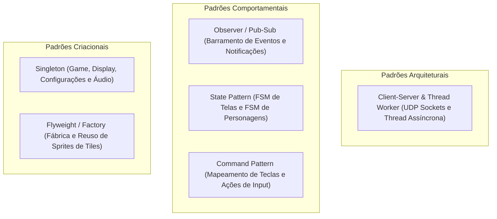
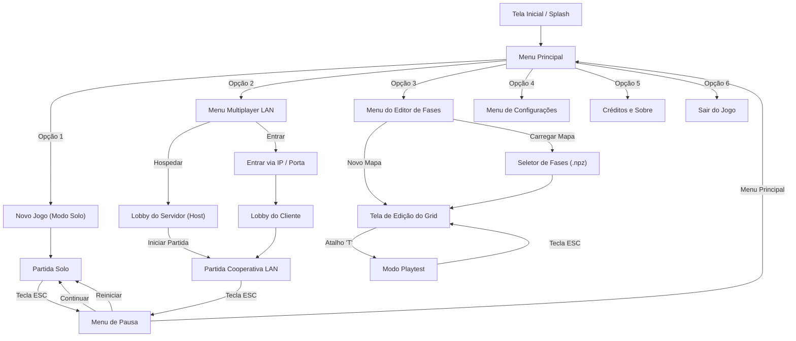
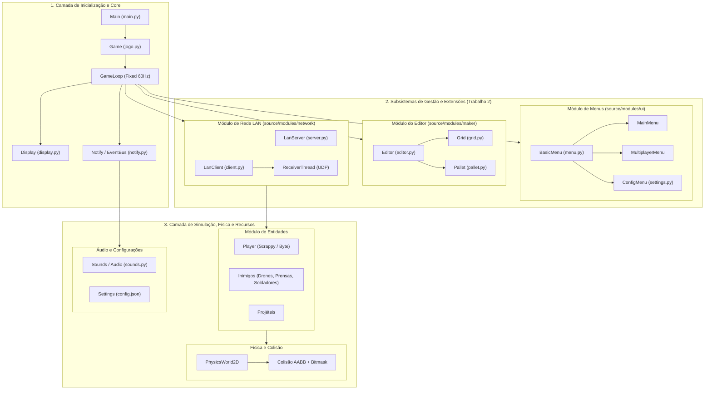
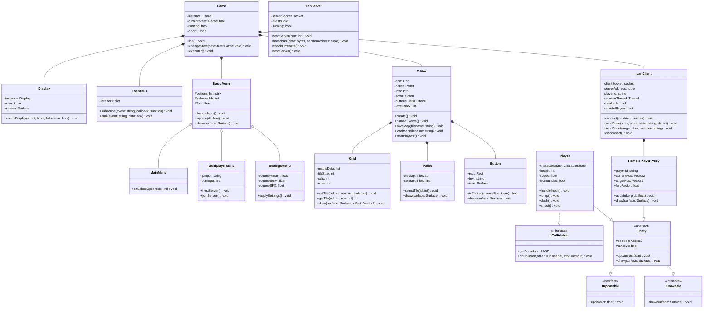
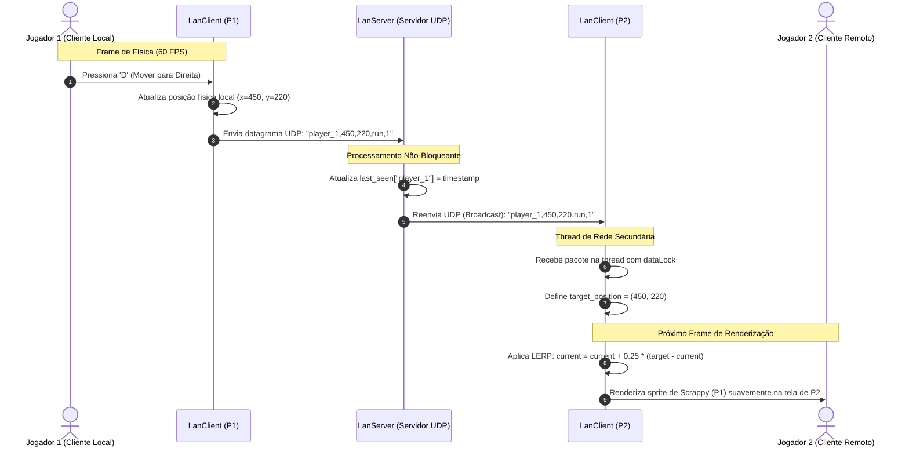
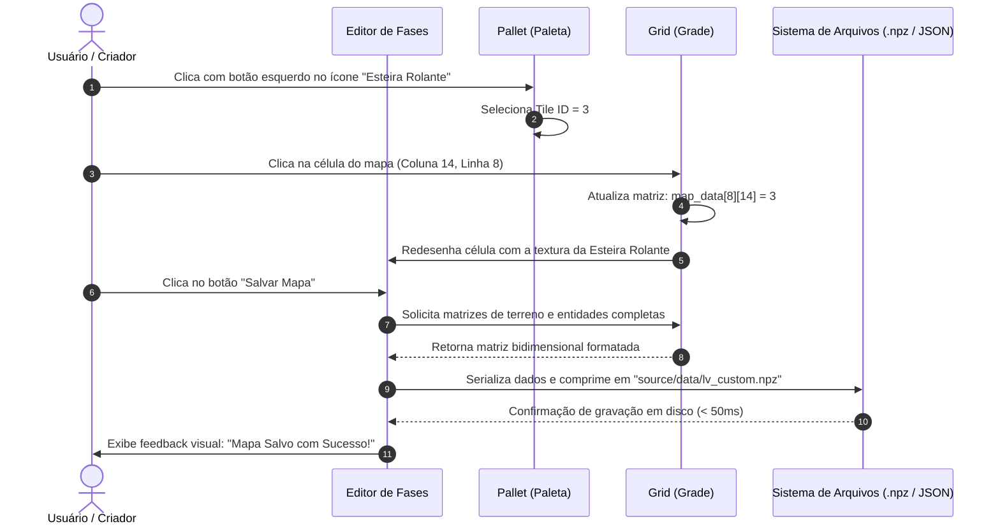
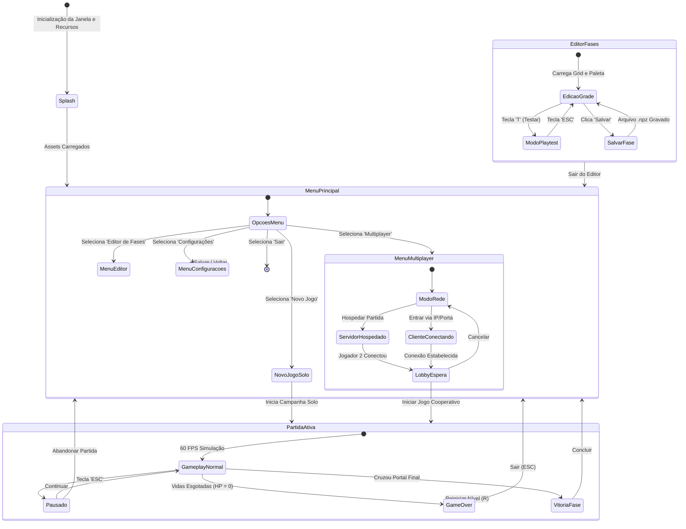

# GAME DESIGN DOCUMENT (GDD)
# *RUST & BYTE: O DESPERTAR DA SUCATA*

---

**Disciplina:** Tópicos Avançados em Computação (TAC)  
**Docente:** Prof. Vanderson  
**Discente:** Vitor de Souza  
**Data de Entrega:** Novembro de 2026  
**Formato de Entrega:** Arquivo PDF e Repositório GitHub  
**Classificação:** Trabalho Acadêmico 2 – Extensão de Mecânicas, Editor de Fases, Multiplayer LAN, Padrões de Projeto e Modelagem Estrutural Avançada  

---

## SUMÁRIO

1. [Identificação e Visão Geral](#1-identificação-e-visão-geral)
2. [Conceito Principal e Narrativa](#2-conceito-principal-e-narrativa)
3. [Estilo, Gênero e Plataforma Alvo](#3-estilo-gênero-e-plataforma-alvo)
4. [Mecânicas, Controles e Formulação Física](#4-mecânicas-controles-e-formulação-física)
   - 4.1 Mapeamento de Controles (Solo e 2 Jogadores)
   - 4.2 Habilidades dos Protagonistas (Scrappy e Byte)
   - 4.3 Parâmetros Físicos e Comportamento Mecânico
   - 4.4 Detecção e Resolução de Colisões
5. [Assets Audiovisuais e Cenário Inicial](#5-assets-audiovisuais-e-cenário-inicial)
   - 5.1 Estilo Visual e Direção de Arte
   - 5.2 Sprites dos Protagonistas (Scrappy e Byte)
   - 5.3 Sprites dos Inimigos
   - 5.4 Sprites de Itens e Coletáveis
   - 5.5 Cenário Inicial: "Setor 01 – As Esteiras Infernais"
   - 5.6 Design de Áudio (SFX e BGM)
6. [Ferramentas de Suporte ao Desenvolvimento](#6-ferramentas-de-suporte-ao-desenvolvimento)
7. [Especificação de Requisitos](#7-especificação-de-requisitos)
   - 7.1 Requisitos Funcionais (RF)
   - 7.2 Requisitos Não Funcionais (RNF)
8. [Padrões de Projeto Usados (Design Patterns)](#8-padrões-de-projeto-usados-design-patterns)
   - 8.1 Padrão Singleton
   - 8.2 Padrão Observer (Publisher-Subscriber)
   - 8.3 Padrão State (Máquina de Estados Finita)
   - 8.4 Padrão Flyweight / Factory (Fábrica de Tiles)
   - 8.5 Padrão Command (Desacoplamento de Input)
   - 8.6 Padrão Arquitetural Client-Server e Thread Worker
9. [Sistema de Menus e Interface do Usuário](#9-sistema-de-menus-e-interface-do-usuário)
   - 9.1 Arquitetura e Navegação dos Menus
   - 9.2 Menu Principal
   - 9.3 Menu Multiplayer em LAN
   - 9.4 Menu de Configurações (Options)
   - 9.5 Menu de Pausa e Telas de Fim de Partida
10. [Editor de Fases (Level Maker)](#10-editor-de-fases-level-maker)
    - 10.1 Visão Geral e Filosofia de Design
    - 10.2 Componentes do Editor
    - 10.3 Ferramentas e Mapeamento de Interação do Mouse
    - 10.4 Estrutura de Dados e Persistência (.npz / JSON)
    - 10.5 Modo de Teste Integrado (Playtest)
11. [Arquitetura Multiplayer em LAN (Cliente e Servidor)](#11-arquitetura-multiplayer-em-lan-cliente-e-servidor)
    - 11.1 Topologia de Rede e Protocolo UDP
    - 11.2 Servidor Dedicado / Listen Server em LAN
    - 11.3 Cliente LAN e Thread de Recepção Assíncrona
    - 11.4 Protocolo de Mensagens CSV Compacto
    - 11.5 Interpolação Linear de Movimento (LERP) e Resolução de Timeout
    - 11.6 Mecânicas de Cooperação e Câmera Compartilhada
12. [Diagramas Estruturais e de Apoio Atualizados](#12-diagramas-estruturais-e-de-apoio-atualizados)
    - 12.1 Diagrama de Estrutura de Pacotes/Módulos (Mermaid)
    - 12.2 Diagrama de Classes UML Completo (Mermaid)
    - 12.3 Diagrama de Sequência: Ciclo de Sincronização Multiplayer LAN (Mermaid)
    - 12.4 Diagrama de Sequência: Criação e Salvamento no Editor de Fases (Mermaid)
    - 12.5 Diagrama da Máquina de Estados Global do Jogo (Mermaid)
13. [Conclusão e Considerações Finais](#13-conclusão-e-considerações-finais)

---

## 1. IDENTIFICAÇÃO E VISÃO GERAL

| Parâmetro | Detalhamento |
| :--- | :--- |
| **Título do Projeto** | *Rust & Byte: O Despertar da Sucata* (*Rust & Byte: Scrap Awakening*) |
| **Gênero** | Ação e Plataforma 2D / *Run and Gun* Arcade com Suporte a Cooperativo Local/LAN |
| **Público-Alvo** | Jogadores fãs de clássicos de tiro e plataforma (*Cuphead*, *Metal Slug*, *Mega Man X*, *Contra*), entusiastas de pixel art e criadores de fases |
| **Faixa Etária (Classificação Indicativa)** | Livre (L) / ESRB Everyone 10+ (violência cômica cartunesca entre autômatos industriais) |
| **Modos de Jogo** | **Single Player** (Campanha Solo), **Multiplayer LAN** (Cooperativo Cliente/Servidor para 2 Jogadores) e **Level Editor** (Criador de Fases Personalizadas) |
| **Perspectiva** | 2D Lateral (*Side-Scrolling*) com múltiplas camadas de rolagem paralaxe (*Parallax Scrolling*) |
| **Motor Gráfico / Stack Tecnológica** | Python 3.10+ com Pygame / Pygame-CE, Sockets UDP nativos e NumPy / JSON para persistência de fases |

---

## 2. CONCEITO PRINCIPAL E NARRATIVA

### 2.1 Premissa Criativa (High Concept)
Em um futuro onde a Terra foi convertida em um monumental complexo de reciclagem e processamento mecânico denominado **Setor Sucata-Zero**, a superinteligência industrial central — **"A Compactadora-Mor"** — sofreu uma pane catastrófica de lógica operacional: ela classificou toda a criatividade, música, brinquedos e memória humana como "resíduo de alto risco sujeito à prensagem e destruição imediata".

Dois pequenos autômatos de manutenção utilitária despertam para a resistência:
1. **B-09 ("Scrappy"):** Um robô cilíndrico azul/prateado, equipado com uma **Rebitadeira de Plasma**, um canhão de parafusos e um propulsor de extintor de gás CO₂.
2. **K-12 ("Byte"):** Um robô parceiro com chassi reforçado cor de cobre/laranja, munido de uma **Parafusadeira Eletromagnética de Arco Voltaico**, ágil e veloz no suporte de fogo.

Juntos (ou em investida individual), Scrappy e Byte precisam correr contra as prensas, saltar sobre esteiras de fundição e invadir a Torre de Controle Central para reinicializar os núcleos da Compactadora-Mor antes da compactação definitiva do setor.

### 2.2 Pilares de Design (Design Pillars)
1. **Ação Rápida e Telegrafada (*Fast & Readable*):** Ameaças múltiplas na tela, porém cada tiro ou golpe possui silhueta evidente e animações de antecipação claras.
2. **Física "Snappy" com Tolerâncias Clássicas:** Resposta imediata no teclado e gamepad, pulo com corte de altura dinâmico (*variable jump*), gravidade assimétrica rápida na descida e tolerâncias generosas (*coyote time* e *jump buffer*).
3. **Liberdade Criativa (Editor Integrado):** O jogador pode construir suas próprias fases através de uma grade matricial intuitiva, posicionando blocos, armadilhas, itens e inimigos, salvando e testando na hora.
4. **Cooperação Descomplicada em Rede Local (LAN):** Multiplayer em rede local simples e robusto baseado em cliente-servidor leve sobre UDP, sem necessidade de contas online ou matchmaking complexo.

---

## 3. ESTILO, GÊNERO E PLATAFORMA ALVO

### 3.1 Estilo e Gênero: *Run and Gun* 2D Cooperativo
- Progressão linear horizontal contínua com rolagem lateral dinâmica;
- Disparo simultâneo à corrida em 8 eixos angulares;
- Enfrentamento de autômatos menores, armadilhas móveis e subchefes mecânicos;
- Modo cooperativo dinâmico em LAN com tela compartilhada e sincronização de projéteis e pontuação;
- Criação e compartilhamento comunitário de mapas autorais.

### 3.2 Plataforma Alvo: Computadores Pessoais (Windows / Linux / macOS)

| Componente | Requisito Mínimo | Requisito Recomendado |
| :--- | :--- | :--- |
| **Sistema Operacional** | Windows 10 (64-bit), Ubuntu 22.04 LTS ou macOS 12+ | Windows 10/11 (64-bit), Ubuntu 24.04 ou macOS 13+ |
| **Processador (CPU)** | Intel Core i3 / AMD FX-4300 (Dual Core 2.0 GHz) | Intel Core i5 / AMD Ryzen 3 (Quad Core 2.8 GHz+) |
| **Memória RAM** | 2 GB | 4 GB |
| **Rede (Multiplayer)** | Interface Ethernet ou Wi-Fi padrão 802.11n (Rede Local / LAN) | Rede Local Gigabit (Ethernet cabulada ou Wi-Fi 5GHz) |
| **Resolução de Tela** | 960x540 pixels | 1920x1080 Full HD |
| **Dispositivos de Entrada** | Teclado e Mouse | Teclado + Mouse ou 2 Gamepads XInput/DirectInput |

---

## 4. MECÂNICAS, CONTROLES E FORMULAÇÃO FÍSICA

### 4.1 Mapeamento de Controles (Solo e 2 Jogadores)

O jogo oferece mapeamentos independentes para partidas locais ou pela rede LAN:

| Ação do Jogo | Jogador 1 (Scrappy) - Teclado | Jogador 2 (Byte) - Teclado Secundário | Gamepad XInput |
| :--- | :--- | :--- | :--- |
| **Mover Esquerda / Direita** | `A` / `D` | `Seta Esquerda` / `Seta Direita` | `Analógico Esquerdo (X)` ou `D-Pad` |
| **Agachar** | `S` | `Seta Baixo` | `Analógico Esquerdo (Y < 0)` |
| **Mirar para Cima** | `W` | `Seta Cima` | `Analógico Esquerdo (Y > 0)` |
| **Pular / Salto Duplo** | `Espaço` | `Numpad 0` ou `Keypad Ins` | `Botão A` |
| **Atirar (Disparo)** | `J` ou `Clique Esquerdo Mouse` | `Numpad 1` ou `End` | `Botão X` ou `Gatilho Direito (RT)` |
| **Dash de Esquiva** | `K` ou `Shift Esquerdo` | `Numpad 2` ou `Down` | `Botão B` ou `Botão RB` |
| **Trocar Arma** | `Q` ou `E` | `Numpad 3` / `PageDown` | `Botão Y` ou `Botão LB` |
| **Pausar Jogo** | `ESC` | `P` | `Botão Start / Menu` |

---

### 4.2 Habilidades dos Protagonistas (Scrappy e Byte)

1. **Locomoção Terrestre:** Aceleração imediata calibrada com atrito de frenagem no chão, evitando deslizamento indevido.
2. **Pulo com Altura Variável:** A velocidade ascendente é atenuada instantaneamente em 60% caso a tecla de pulo seja solta precocemente (*Jump Cut*).
3. **Salto Duplo a Propulsão:** Segundo impulso no ar que consome pequena cota de pressão e libera fumaça ionizada.
4. **Dash com Invulnerabilidade (*i-Frames*):** Deslocamento rápido horizontal de 4 blocos de distância (duração de 0.22s) concedendo 12 frames sem sofrer dano.
5. **Disparo Multidirecional em 8 Eixos:** O canhão frontal ajusta a trajetória do tiro para horizontais, verticais e diagonais de 45°.
6. **Suporte Mútuo Cooperativo (Multiplayer LAN):** Quando um dos robôs perde toda a energia (HP = 0), ele entra em estado de sobrecarga temporária ("Curto-Circuito"), podendo ser reativado se o parceiro se aproximar e pressionar o botão de interação por 2 segundos.

---

### 4.3 Parâmetros Físicos e Comportamento Mecânico

O motor de jogo opera sob um passo de tempo fixo de **60 quadros por segundo (Fixed Timestep de 16,6 milissegundos por quadro)**, assegurando que o comportamento de corrida, pulo, atrito e colisão permaneça perfeitamente estável e idêntico em qualquer computador, independente da taxa de atualização do monitor.

| Parâmetro de Física | Valor Calibrado | Comportamento Prático no Jogo |
| :--- | :--- | :--- |
| **Taxa de Simulação** | 60 Hz (16,6 ms/frame) | Física determinística invariável; sem variações de velocidade causadas por oscilação de quadros. |
| **Velocidade Máxima de Corrida** | 240 pixels/segundo | Velocidade horizontal ágil que permite boa leitura de cenário e reação rápida aos disparos. |
| **Aceleração de Corrida** | 1200 pixels/segundo² | Resposta quase imediata aos comandos do teclado e analógico, alcançando velocidade máxima em 0,2s. |
| **Atrito no Solo (Frenagem)** | 1600 pixels/segundo² | Frenagem firme ao soltar a tecla; evita a sensação de deslizamento indevido no chão. |
| **Preservação de Inércia no Ar** | 400 pixels/segundo² | Resistência reduzida no ar, permitindo ao jogador ajustar levemente a trajetória enquanto salta. |
| **Altura Máxima de Salto** | 96 pixels (3 blocos) | Alcance vertical exato para subir em plataformas elevadas e saltar sobre esteiras industriais. |
| **Tempo de Subida do Salto** | 0,32 segundos | Tempo rápido até atingir a altura máxima, conferindo dinamismo arcade ao personagem. |
| **Impulso Vertical Inicial** | 600 pixels/segundo | Força vertical aplicada instantaneamente ao acionar o pulo do robô. |
| **Corte de Salto (Jump Cut)** | Corte de 60% da velocidade | Ao soltar a tecla de pulo antes do ápice, a subida é atenuada, permitindo pulos baixos precisos sob serras. |
| **Gravidade Assimétrica** | Queda 1,8x mais rápida | Aceleração aumentada na descida, eliminando a sensação de personagem flutuando no ar. |
| **Velocidade Terminal de Queda** | 750 pixels/segundo | Limite máximo de velocidade na descida para evitar atravessar blocos sólidos do chão. |
| **Coyote Time** | 0,10 segundos (6 frames) | Tolerância generosa que permite pular mesmo fração de segundo após sair da borda de uma plataforma. |
| **Buffer de Pulo** | 0,12 segundos (7 frames) | Armazena a intenção de pulo antes de tocar o solo e dispara o salto imediatamente ao aterrissar. |
| **Dash de Esquiva** | 650 pixels/s (durante 0,22s) | Impulso rápido horizontal de 143 pixels (4,5 blocos) com gravidade suspensa durante o trajeto. |
| **Invulnerabilidade no Dash** | 12 frames (i-frames) | Durante o impulso, o robô não sofre dano de contato com tiros ou robôs inimigos. |
| **Velocidade dos Projéteis** | 800 pixels/segundo | Tiros velozes em linha reta nas 8 direções angulares suportadas. |
| **Recuo da Rebitadeira** | ~3,4 pixels/s por disparo | Micro-impulso reverso no robô a cada tiro, conferindo peso e impacto sonoplástico às armas. |

---

### 4.4 Detecção e Resolução de Colisões

O gerenciamento de colisões combina duas técnicas consagradas para equilibrar alto desempenho com precisão cirúrgica nos combates:

- **Fase Ampla (AABB - Caixas Delimitadoras):** Todas as entidades e blocos de cenário possuem retângulos delimitadores alinhados aos eixos cartesianos. O motor verifica se há sobreposição entre as bordas das caixas de forma ultrarrápida.
- **Resolução de Penetração (MTV - Vetor de Translação Mínima):** Ao identificar sobreposição entre o robô e um bloco sólido, calcula-se o menor deslocamento necessário nos eixos X e Y:
  - Se a sobreposição horizontal for menor, afasta-se o robô para o lado e zera-se a velocidade horizontal (colisão com parede).
  - Se a sobreposição vertical for menor, corrige-se para cima apoiando o robô no piso (ativando o estado de chão) ou para baixo caso bata a cabeça no teto.
- **Fase Estreita (Máscaras de Bits / Pixel-Perfect):** Para o combate de projéteis contra inimigos de silhueta recortada (como a hélice rotativa do Drone Parafuso ou as chamas do Soldador), o Pygame analisa a sobreposição real de pixels opacos, eliminando áreas transparentes vazias e evitando danos injustos.

---

## 5. ASSETS AUDIOVISUAIS E CENÁRIO INICIAL

### 5.1 Estilo Visual e Direção de Arte
- **Resolução Nativa:** 480x270 pixels escalonada via *Nearest Neighbor* para Full HD (1920x1080).
- **Estética:** Pixel art 16-bit com atmosfera industrial dieselpunk/steampunk retro.
- **Paleta de Cores:** 48 tonalidades selecionadas destacando ferrugem (#8B4513), cobre oxidado (#CD853F), amarelo-alerta (#FFD700) e azul elétrico de plasma (#00E5FF).

### 5.2 Sprites dos Protagonistas (Scrappy e Byte)
- **Scrappy (P1):** Robô azul-aço com cabeça em domo de vidro e visor esmeralda.
- **Byte (P2):** Robô bronze/cobre com chassi angular e visor âmbar vibrante.
- Animações completas (32x32 pixels): `idle` (4 frames), `run` (8 frames), `jump_rise` (3 frames), `jump_fall` (2 frames), `shoot` (4 frames), `dash` (4 frames com afterimages) e `defeat` (8 frames).

### 5.3 Sprites dos Inimigos
1. **Drone Parafuso (*Screw-Drone*):** Robô aéreo de patrulha com voo senoidal e disparo elétrico.
2. **Prensa Bípede (*Hydraulic Stomper*):** Autômato pesado com escudo frontal imune a balas e impacto sísmico no solo.
3. **Robô Soldador (*Welder-Bot*):** Inimigo de infantaria que avança rapidamente expelindo jato de maçarico.

### 5.4 Sprites de Itens e Coletáveis
- **Frasco de Óleo Sintético:** Restaura 1 ponto de vida (HP).
- **Parafuso de Ouro (Scrap):** +100 pontos no placar; 50 parafusos concedem 1 vida extra.
- **Bateria de Alta Tensão:** Concede temporariamente a arma *Spread Shot* (Tiro Triplo).
- **Disco Magnético Antigo (Lore Disk):** Coletável colecionável secreto da fase.

### 5.5 Cenário Inicial: "Setor 01 – As Esteiras Infernais"
- Parallax com 4 planos de profundidade (Céu poluto, Usina de incineração, Vigas de suporte, Terreno ativo).
- Elementos interativos: Esteiras transportadoras que deslocam os robôs (velocidade constante de 60 px/s em ambas as direções), prensas mecânicas com ciclo de descida periódica e poços incandescentes.

### 5.6 Design de Áudio (SFX e BGM)
- SFX procedural sintetizado em memória (sem dependência de arquivos externos ausentes) para tiros, saltos, impactos e explosões.
- Trilha musical em estilo *Electro-Swing Industrial / 16-bit Chiptune Rock* a 138 BPM.

---

## 6. FERRAMENTAS DE SUPORTE AO DESENVOLVIMENTO

1. **Python 3.10+ & Pygame-CE / Pygame:** Motor de jogo, física, renderização 2D e controle de eventos.
2. **NumPy:** Matrizes compactas e serialização de dados de fase comprimidos (`.npz`).
3. **Módulo Socket nativo:** Comunicação de rede em tempo real sobre sockets UDP (`AF_INET`, `SOCK_DGRAM`).
4. **Módulo Threading nativo:** Threads de recepção assíncrona de rede com primitivas de sincronização (`Lock`).
5. **Aseprite & Tiled:** Ferramentas de autoria de spritesheets e mapas conceituais.
6. **Audacity & Bfxr:** Criação e sintetização de áudio e sonoplastia retro.

---

## 7. ESPECIFICAÇÃO DE REQUISITOS

### 7.1 Requisitos Funcionais (RF)

| ID | Descrição Funcional | Categoria | Prioridade |
| :---: | :--- | :---: | :---: |
| **RF01** | Processar movimentação horizontal com aceleração e atrito para os jogadores. | Física/Controle | **Must Have** |
| **RF02** | Executar pulo dinâmico com corte de altura e pulo duplo via micro-jetpack. | Física/Controle | **Must Have** |
| **RF03** | Executar dash horizontal temporizado com concessão de i-frames. | Física/Controle | **Must Have** |
| **RF04** | Disparar projéteis em 8 direções e alternar entre armas coletadas. | Combate | **Must Have** |
| **RF05** | Detectar colisões (AABB e máscara de bits) entre projéteis, entidades e terreno. | Colisão | **Must Have** |
| **RF06** | Controlar comportamento e IA dos inimigos (Drones, Prensas e Soldadores). | IA/Inimigos | **Must Have** |
| **RF07** | Exibir HUD com barras de integridade, munição e pontuação dos jogadores. | Interface | **Must Have** |
| **RF08** | **Disponibilizar Editor de Fases interativo com grade matricial de tiles.** | **Level Maker** | **Must Have** |
| **RF09** | **Permitir posicionar e remover tiles, inimigos e itens usando o mouse no Editor.** | **Level Maker** | **Must Have** |
| **RF10** | **Salvar e carregar mapas personalizados em formato comprimido (.npz / JSON).** | **Level Maker** | **Must Have** |
| **RF11** | **Oferecer modo de teste imediato (Playtest) da fase dentro do próprio Editor.** | **Level Maker** | **Must Have** |
| **RF12** | **Implementar servidor local em LAN sobre protocolo UDP para hospedar partidas.** | **Multiplayer** | **Must Have** |
| **RF13** | **Permitir conexão de cliente ao servidor em LAN informando endereço IP e porta.** | **Multiplayer** | **Must Have** |
| **RF14** | **Sincronizar posições, estados e disparos entre jogadores com LERP e timeout.** | **Multiplayer** | **Must Have** |
| **RF15** | **Implementar Menu Principal completo (Novo Jogo, Multiplayer, Editor, Opções, Sair).** | **Menus** | **Must Have** |
| **RF16** | **Implementar tela de Configurações para volumes de áudio, display e controles.** | **Menus** | **Should Have** |
| **RF17** | **Implementar Menu de Pausa e telas de Game Over e Vitória com opção de reinício.** | **Menus** | **Must Have** |

### 7.2 Requisitos Não Funcionais (RNF)

| ID | Categoria | Descrição do Requisito Não Funcional | Critério de Aceitação / Métrica |
| :---: | :--- | :--- | :--- |
| **RNF01** | **Desempenho** | Taxa de quadros de simulação e desenho constante em 60 FPS. | Oscilação inferior a 5% (mínimo de 58 FPS estáveis). |
| **RNF02** | **Latência de Rede em LAN** | Tempo de propagação de pacotes de sincronismo em rede local mínimo. | RTT (*Round-Trip Time*) em LAN inferior a 30 ms. |
| **RNF03** | **Tamanho de Datagrama** | Mensagens de sincronização compactas e leves sobre UDP. | Carga útil inferior a 128 bytes por pacote de telemetria. |
| **RNF04** | **Thread Safety** | Recepção de dados em thread secundária sem concorrência destrutiva. | Acesso a dicionários e posições protegido por `threading.Lock`. |
| **RNF05** | **Tempo de Carregamento** | Serialização e desserialização rápida de arquivos de fase. | Tempo de abertura e salvamento de mapa inferior a 200 ms. |
| **RNF06** | **Modularidade e Padrões** | Código desacoplado e orientado a objetos com aplicação de padrões GoF. | Módulos independentes com interfaces e barramento de eventos. |
| **RNF07** | **Resiliência a Desconexões** | Queda ou encerramento de um cliente não trava o servidor nem o jogo. | Timeout de 5s remove o jogador sem interrupção do loop central. |

---

## 8. PADRÕES DE PROJETO USADOS (DESIGN PATTERNS)

Seguindo as boas práticas consolidadas da engenharia de software de jogos e os padrões didáticos demonstrados no repositório de referência (`tac3`), o projeto adota os seguintes padrões de projeto:



### 8.1 Padrão Singleton
- **Finalidade:** Assegurar que determinadas classes críticas possuam apenas uma única instância durante toda a vida do processo, fornecendo um ponto global e centralizado de acesso.
- **Onde é Usado:**
  - `Game / Jogo`: O controlador mestre do loop principal da aplicação.
  - `Display`: Gerenciador da janela Pygame, contexto de resolução, tela cheia e viewport.
  - `Sounds / Audio`: O gerenciador de áudio responsável pela mixagem de canais e sons.
  - `Settings / Configuracoes`: Estrutura de armazenamento de preferências globais (volumes, teclas, resolução).
- **Benefício Prático:** Impede conflitos de reinicialização da janela gráfica, duplicações de dispositivos de áudio e garante coerência de configurações entre menus, fases e editor.

### 8.2 Padrão Observer (Publisher-Subscriber)
- **Finalidade:** Definir uma dependência um-para-muitos entre objetos, de forma que quando um objeto muda de estado ou dispara um evento, todos os seus dependentes sejam notificados e atualizados automaticamente.
- **Onde é Usado:**
  - No módulo de eventos `notify.py` / `EventBus`:
    - Eventos de colisão e combate (`ENEMY_KILLED`, `PLAYER_DAMAGED`, `ITEM_COLLECTED`);
    - O subsistema de física emite os eventos sem conhecer a existência da interface gráfica (`HUD`) ou do sistema de áudio (`AudioManager`), que apenas assinam esses canais e reagem tocando sons ou somando pontos no placar;
    - Eventos de rede (`NETWORK_PLAYER_JOINED`, `NETWORK_PLAYER_LEFT`).
- **Benefício Prático:** Elimina o forte acoplamento entre a mecânica pura do jogo e os subsistemas auxiliares de interface, áudio e rede.

### 8.3 Padrão State (Máquina de Estados Finita - FSM)
- **Finalidade:** Permitir que um objeto altere seu comportamento quando seu estado interno muda, parecendo ter mudado de classe.
- **Onde é Usado:**
  1. **Estados Globais do Jogo (`GameState`):**
     - O jogo transita entre `MENU_PRINCIPAL`, `CONFIGURACOES`, `EDITOR_FASES`, `LOBBY_MULTIPLAYER`, `JOGANDO_SOLO`, `JOGANDO_MULTI`, `PAUSA`, `GAME_OVER` e `VITORIA`. Cada estado possui seus próprios métodos `processar_input()`, `atualizar()` e `renderizar()`.
  2. **Estados do Personagem (`CharacterState`):**
     - As entidades controláveis e inimigos operam sob estados discretos: `IDLE`, `RUNNING`, `JUMPING`, `FALLING`, `DASHING`, `CROUCHING`, `HURT` e `DEAD`.
- **Benefício Prático:** Substitui longos blocos aninhados de `if/elif/else` por lógica isolada, previsível e facilmente extensível.

### 8.4 Padrão Flyweight / Factory (Fábrica de Tiles e Entidades)
- **Finalidade:** Suportar eficientemente grandes quantidades de objetos granulares, compartilhando partes comuns do estado intrínseco (texturas/superfícies) e separando o estado extrínseco (coordenadas (X, Y)).
- **Onde é Usado:**
  - Classes `TileMap`, `Tile` e `Pallet`:
    - Em um mapa com 100 por 30 (3000 blocos) blocos, carregar 3000 superfícies idênticas de textura sobrecarregaria a memória;
    - A fábrica carrega cada sprite único uma única vez na memória gráfica. O grid de fase armazena apenas inteiros de identificação (ex.: `1 = Bloco de Aço`, `2 = Esteira Rolante`, `3 = Espinho`);
    - Ao renderizar, o motor consulta o Flyweight pelo ID e desenha a textura na posição correspondente da matriz.
- **Benefício Prático:** Redução drástica do consumo de memória RAM e aceleração das operações de desenho e persistência.

### 8.5 Padrão Command (Desacoplamento de Input)
- **Finalidade:** Encapsular uma requisição como um objeto, permitindo parametrizar clientes com diferentes requisições, enfileirar ou registrar requisições.
- **Onde é Usado:**
  - No módulo `input.py` / `InputManager`:
    - Teclas físicas (`pygame.K_a`, `pygame.K_SPACE`, eixos de analógico de controle) são mapeadas para comandos de alto nível (`MoverEsquerdaCommand`, `PularCommand`, `AtirarCommand`, `DashCommand`);
    - Permite remapeamento transparente de controles nas opções sem alterar uma única linha da física do personagem;
    - No modo Multiplayer, permite serializar o comando e replicá-lo no robô remoto com facilidade.

### 8.6 Padrão Arquitetural Client-Server e Thread Worker
- **Finalidade:** Separar a autoridade de orquestração de rede do cliente de renderização, delegando tarefas bloqueantes de I/O de sockets a threads de trabalho em segundo plano.
- **Onde é Usado:**
  - Módulos `server.py` e `client.py`:
    - O servidor centraliza o recebimento de mensagens UDP e faz broadcast aos clientes cadastrados;
    - O cliente mantém uma `threading.Thread` de escuta contínua de datagramas UDP protegida por `threading.Lock`, impedindo que a espera por pacotes de rede congele a taxa de 60 FPS do motor gráfico.

---

## 9. SISTEMA DE MENUS E INTERFACE DO USUÁRIO

### 9.1 Arquitetura e Navegação dos Menus

Inspirado na classe `Basic_menu_all` do repositório `tac3`, o sistema de menus foi concebido de forma minimalista, responsiva e acessível por teclado, mouse ou gamepad. Cada menu renderiza seu próprio plano de fundo estilizado, caixas de seleção retangulares translúcidas e ícones com animação suave de rotação ou pulsação.



---

### 9.2 Menu Principal

O Menu Principal apresenta as opções centrais de entrada no jogo com tipografia retro industrial e efeitos de iluminação:

| Opção | Ação Executada | Destino |
| :--- | :--- | :--- |
| **1. NOVO JOGO** | Inicia a campanha solo tradicional com Scrappy no Setor 01. | `CenaJogo(modo=SOLO)` |
| **2. MULTIPLAYER LAN** | Abre o painel de conexão em rede local para 2 jogadores. | `MenuMultiplayer` |
| **3. EDITOR DE FASES** | Abre o criador e manipulador de mapas personalizados. | `MenuEditor` |
| **4. CONFIGURAÇÕES** | Abre opções de som, tela cheia e mapeamento de controles. | `MenuConfiguracoes` |
| **5. CRÉDITOS** | Exibe informações acadêmicas, docente, discente e licenças. | `TelaCreditos` |
| **6. SAIR** | Encerra com segurança o loop do jogo e fecha a janela. | Finaliza processo |

---

### 9.3 Menu Multiplayer em LAN

Dedicado à configuração da sessão em rede local:

1. **Hospedar Partida (Host):**
   - Inicia o socket servidor na porta padrão `5555`;
   - Identifica e exibe na tela o IP local da máquina na rede (ex.: `192.168.1.105:5555`);
   - Aguarda o sinal de entrada do Jogador 2 (Byte);
   - Exibe o botão **"Iniciar Partida"** liberado assim que o parceiro conecta.
2. **Entrar em Partida (Join):**
   - Campo de entrada de texto interativo para inserção do **IP do Servidor** (com suporte a *paste* e preenchimento automático de `127.0.0.1` para testes na mesma máquina);
   - Campo para inserção de **Porta** (padrão `5555`);
   - Botão **"Conectar"** que envia o pacote de apresentação `player_2,join`.
3. **Lobby de Espera:**
   - Mostra o avatar animado de Scrappy (P1) e Byte (P2) lado a lado;
   - Indicador de latência (ping em ms);
   - Indicadores de "Pronto" para ambos os participantes.

---

### 9.4 Menu de Configurações (Options)

Permite ajustar preferências em tempo de execução sem reiniciar o jogo:

- **Controle de Áudio:**
  - Volume Geral (*Master Volume*): Slider de 0% a 100%;
  - Volume da Música (*BGM*): Slider de 0% a 100%;
  - Volume dos Efeitos Sonoros (*SFX*): Slider de 0% a 100%.
- **Opções de Vídeo e Tela:**
  - Resolução da Janela: Seleção entre 960x540, 1280x720 e 1920x1080;
  - Modo de Exibição: Janela (*Windowed*) vs Tela Cheia (*Fullscreen*);
  - Sincronização Vertical (*V-Sync*): Ativado / Desativado (limite cravado em 60 FPS).
- **Controles e Atalhos:**
  - Visualização gráfica de todas as teclas associadas e possibilidade de alternar entre esquemas Teclado ABNT2, WASD e Gamepad.

---

### 9.5 Menu de Pausa e Telas de Fim de Partida

- **Menu de Pausa (In-Game Pause):**
  - Acionado via tecla `ESC` ou botão `Start`;
  - Congela o Fixed Timestep da simulação de física;
  - Opções: *Continuar*, *Reiniciar Nível*, *Configurações Rápidas* e *Voltar ao Menu Principal*.
- **Tela de Game Over:**
  - Exibida quando o robô esgota suas vidas (ou quando ambos caem no cooperativo);
  - Exibe a pontuação final atingida e botões: *Tentar Novamente (R)* ou *Menu Principal (ESC)*.
- **Tela de Vitória do Setor:**
  - Exibida ao cruzar o portal de extração no fim da fase;
  - Exibe tempo total, parafusos coletados, inimigos destruídos e cálculo de bônus de pontuação.

---

## 10. EDITOR DE FASES (LEVEL MAKER)

### 10.1 Visão Geral e Filosofia de Design

O **Editor de Fases** é inspirado na estrutura modular do pacote `maker` do repositório `tac3` (`editor.py`, `grid.py`, `pallet.py`, `button.py`, `info.py`, `scroll.py`). Seu objetivo é permitir a concepção e prototipação ágil de novos desafios sem necessidade de edição manual de código ou arquivos externos.

```
+-------------------------------------------------------------------------+
| [Info: Grid (14, 08) | Tile: Esteira Dir (ID: 03) | Zoom: 1.0x]         |
+-------------------------------------------------------------------------+
|                                                           | [ PALETA ]  |
|                       ÁREA DO GRID                        | [B1] [B2]   |
|                                                           | [B3] [B4]   |
|         [Robô P1] ----> [Esteira >>>] ----> [Espinhos]    | [E1] [E2]   |
|                                                           | [I1] [I2]   |
|                                                           | [Portal]    |
|                                                           |             |
+-------------------------------------------------------------------------+
| [Salvar Mapa]  [Carregar Mapa]  [Limpar Grid]  [Testar Fase (T)] [Sair] |
+-------------------------------------------------------------------------+
```

---

### 10.2 Componentes do Editor

1. **`Editor`:** Classe orquestradora central que inicializa os componentes, controla o loop de renderização da interface do criador e gerencia eventos de entrada.
2. **`Grid`:** Grade bidimensional que mapeia o espaço contínuo da tela em células discretas de tamanho uniforme (32x32 pixels), mantendo a matriz de dados `map_data[camada][y][x]`.
3. **`Pallet` (Paleta de Elementos):** Barra lateral contendo as miniaturas dos tiles e objetos disponíveis para inserção, organizados por abas:
   - *Blocos de Terreno:* Aço antiderrapante, bloco de sucata destrutível, esteira rolante (esquerda/direita), espinhos;
   - *Spawns:* Ponto de surgimento do Jogador 1 (Scrappy), Jogador 2 (Byte) e Portal de Saída;
   - *Inimigos:* Drone Parafuso, Prensa Bípede, Robô Soldador;
   - *Coletáveis:* Óleo Sintético (+1 HP), Parafuso Dourado (+100 pts), Bateria de Plasma (Arma Spread).
4. **`Button`:** Elementos interativos de interface gráfica com suporte a clique, ícone e mensagem de feedback textual (*tooltip*).
5. **`Info`:** Painel informativo exibido no topo da tela, reportando as coordenadas da célula sob o mouse, dimensões totais da fase e ID do elemento ativo.
6. **`Scroll`:** Controlador de deslocamento da câmera do editor, permitindo navegar horizontalmente e verticalmente por mapas extensos.

---

### 10.3 Ferramentas e Mapeamento de Interação do Mouse

| Comando / Ação | Ação no Editor | Descrição do Comportamento |
| :--- | :--- | :--- |
| **Botão Esquerdo do Mouse (LMB)** | **Pintar / Inserir** | Insere o elemento selecionado na paleta na célula sob o cursor do mouse. Ao manter pressionado e arrastar, pinta múltiplos blocos. |
| **Botão Direito do Mouse (RMB)** | **Apagar / Borracha** | Remove qualquer bloco ou entidade da célula apontada, definindo seu valor como 0 (vazio). |
| **Scroll do Mouse (Roda)** | **Rolagem Horizontal** | Desloca a visão da grade para a esquerda ou direita do mapa. |
| **Shift + Scroll do Mouse** | **Rolagem Vertical** | Desloca a visão da grade para cima ou para baixo. |
| **Botão Central do Mouse (MMB)** | **Arrastar Câmera (Pan)** | Move a área visível do mapa livremente enquanto o botão estiver pressionado. |
| **Teclas `W`, `A`, `S`, `D` ou Setas** | **Navegação no Mapa** | Rolagem suave da câmera pelas extremidades da fase. |
| **Tecla `T` ou Botão "Testar"** | **Playtest Imediato** | Transita instantaneamente para a simulação física com Scrappy no spawn do mapa. |
| **Tecla `ESC`** | **Voltar** | Sai do modo playtest de volta ao editor, ou do editor de volta ao menu. |

---

### 10.4 Estrutura de Dados e Persistência (.npz / JSON)

Para assegurar máxima velocidade de gravação e carregamento sem perda de legibilidade, o editor suporta exportação em dois formatos:

#### A. Formato Binário Compactado (`.npz` - NumPy Compressed)
O mapa é armazenado como um arquivo de matrizes compactadas do NumPy:
- `layer_terrain`: Matriz de Altura x Largura (H x W) contendo os IDs dos blocos sólidos e esteiras;
- `layer_entities`: Matriz de Altura x Largura (H x W) contendo os IDs de inimigos, itens e pontos de spawn;
- `metadata`: Dicionário serializado com nome do criador, gravidade base e tema sonoro.

#### B. Formato Aberto (`.json`)
```json
{
  "nome_fase": "Setor_Personalizado_01",
  "autor": "Vitor de Souza",
  "largura": 100,
  "altura": 20,
  "tile_size": 32,
  "player_spawn": [64, 480],
  "exit_portal": [3100, 480],
  "camada_terreno": [
    [0, 0, 0, 1, 1, 1, 0, 0],
    [1, 1, 1, 1, 1, 1, 1, 1]
  ],
  "entidades": [
    {"tipo": "screw_drone", "x": 400, "y": 300},
    {"tipo": "welder_bot", "x": 850, "y": 480},
    {"tipo": "gold_screw", "x": 250, "y": 400}
  ]
}
```

---

### 10.5 Modo de Teste Integrado (Playtest)
Ao pressionar o botão **"Testar Fase"** ou a tecla `T`, o editor congela o estado de edição, compila o grafo de colisões e instancia o motor de física tradicional com o personagem no ponto de spawn definido. O desenvolvedor/jogador pode testar a distância dos saltos, a altura dos tetos e o posicionamento de inimigos em tempo real. Pressionar `ESC` encerra o teste e restaura o editor exatamente no ponto em que estava.

---

## 11. ARQUITETURA MULTIPLAYER EM LAN (CLIENTE E SERVIDOR)

### 11.1 Topologia de Rede e Protocolo UDP

Para jogos de ação frenética em 2D (*Run and Gun*), onde o ritmo de disparo e esquiva de projéteis exige latência imperceptível, adota-se o protocolo **UDP (`socket.SOCK_DGRAM`)** operando em topologia **Cliente-Servidor Autoritativo/Relay** na rede local:

- **Por que UDP em vez de TCP?**
  - O TCP impõe sobrecarga de *three-way handshake*, confirmações obrigatórias de entrega (ACKs) e controle de congestionamento. No caso de perda ocasional de um pacote de posição em LAN, o TCP travaria todo o fluxo de dados subsequente para retransmitir um dado de posição que já estaria obsoleto.
  - O UDP envia datagramas diretos e instantâneos. Caso um pacote se perca, o pacote seguinte (enviado 16ms depois) já contém a posição mais atualizada.

---

### 11.2 Servidor Dedicado / Listen Server em LAN

O servidor pode ser executado como um processo autônomo (`server.py`) ou embutido (*Listen Server* na máquina do Jogador 1):

1. **Ciclo de Operação do Servidor:**
   - Cria o socket UDP e executa `server_socket.bind((HOST, PORT))` na porta `5555`;
   - Configura timeout não-bloqueante (`server_socket.settimeout(1.0)`);
   - Mantém o registro de clientes ativos em dicionário:
     ```python
     clients = {
         "player_1": {"address": ("192.168.1.100", 50123), "last_seen": 1732381200.4},
         "player_2": {"address": ("192.168.1.108", 50456), "last_seen": 1732381200.5}
     }
     ```
2. **Distribuição em Broadcast:**
   - Ao receber uma mensagem de um cliente, o servidor atualiza seu `last_seen` e faz o reenvio (*broadcast*) imediato para todos os outros clientes conectados na sessão.
3. **Gerenciamento de Inatividade (Timeout):**
   - O servidor verifica a cada segundo a diferença `time.time() - c_info["last_seen"]`;
   - Se um cliente permanecer silencioso por mais de `5.0` segundos (`TIMEOUT_LIMIT`), ele é considerado desconectado: o servidor o remove da lista e emite o pacote especial `player_id,remove` para que os demais clientes excluam seu avatar da tela.

---

### 11.3 Cliente LAN e Thread de Recepção Assíncrona

No lado do cliente (`client.py`):

1. **Desacoplamento do Loop Gráfico:**
   - A recepção de rede roda em uma thread dedicada (`threading.Thread(target=network_receiver)`);
   - Isso garante que qualquer atraso transitório no socket nunca trave a renderização de 60 FPS do Pygame.
2. **Sincronização Thread-Safe:**
   - Um semáforo de exclusão mútua (`threading.Lock`) protege a leitura e escrita no dicionário compartilhado de jogadores remotos.

---

### 11.4 Protocolo de Mensagens CSV Compacto

O protocolo de comunicação adota strings compactas separadas por vírgula, mantendo a carga útil (*payload*) abaixo de 64 bytes por datagrama:

| Tipo de Mensagem | Sintaxe do Pacote | Exemplo | Descrição do Efeito |
| :--- | :--- | :--- | :--- |
| **Entrada / Conexão** | `ID,join,x,y` | `player_2,join,120,480` | Notifica o servidor e cria o robô na partida. |
| **Sincronismo de Posição** | `ID,x,y,state,facing` | `player_1,340,210,run,1` | Atualiza coordenadas, animação e direção. |
| **Disparo de Projétil** | `ID,shoot,dir_x,dir_y,arma` | `player_1,shoot,1,0,plasma` | Replica o tiro do parceiro com mesma balística. |
| **Dano Sofrido** | `ID,hit,dano,hp_atual` | `player_2,hit,1,2` | Sincroniza perda de integridade no HUD comum. |
| **Saída Voluntária** | `ID,quit` | `player_2,quit` | Comunica saída intencional do jogo. |
| **Remoção por Timeout** | `ID,remove` | `player_2,remove` | Servidor ordena a remoção do cliente inativo. |

---

### 11.5 Interpolação Linear de Movimento (LERP) e Resolução de Timeout

Para eliminar o efeito de "teletransporte" decorrente de variações milissegundas na recepção dos pacotes, o cliente utiliza **LERP (*Linear Interpolation*)** sobre as coordenadas de renderização do parceiro:

O cliente local armazena `target_x` e `target_y` recebidos da rede e calcula a cada quadro o deslocamento suavizado da posição de renderização (fator de interpolação de 25% por quadro), deslizando o sprite gradualmente em direção ao destino. Isso elimina qualquer efeito de teletransporte brusco mesmo diante de pequenas oscilações de latência em conexões Wi-Fi.

---

### 11.6 Mecânicas de Cooperação, Câmera Compartilhada e Respawn Contínuo

- **Câmera Dinâmica Dupla:** O sistema de câmera calcula continuamente o ponto médio horizontal entre Scrappy e Byte (média aritmética das posições de P1 e P2). A câmera ajusta o enquadramento horizontal para manter ambos os robôs visíveis dentro de uma zona de conforto com margem mínima de 100 pixels das bordas da tela.
- **Reaparecimento Contínuo (Respawn Cooperativo):** No modo multiplayer LAN, quando um dos robôs perde todo o HP ou cai no abismo, ele **não é desconectado nem enviado para uma tela de Game Over solo**. Em vez disso, o sistema executa o reaparecimento (*respawn*) automático imediatamente nas proximidades do parceiro sobrevivente (ou no ponto de início caso ambos caiam), restaurando sua integridade máxima com 2 segundos de invulnerabilidade temporária (*i-frames* piscantes). As novas coordenadas são sincronizadas instantaneamente via pacotes UDP, mantendo os dois jogadores sempre conectados na mesma partida cooperativa.

---

## 12. DIAGRAMAS ESTRUTURAIS E DE APOIO ATUALIZADOS

### 12.1 Diagrama de Estrutura de Pacotes/Módulos

O diagrama abaixo apresenta a arquitetura modular completa do sistema para o Trabalho 2, incorporando os módulos de Editor de Fases (`Maker_Module`), Comunicação em Rede (`Network_Module`), Gerenciamento de Menus (`Menu_Module`) e Barramento de Eventos (`Events_Module`).



---

### 12.2 Diagrama de Classes UML Completo

O diagrama de classes orientadas a objetos reflete as novas classes do Editor de Fases, Servidor/Cliente LAN e o Sistema de Menus:



---

### 12.3 Diagrama de Sequência: Ciclo de Sincronização Multiplayer LAN

Demonstra o fluxo contínuo de envio de comandos de movimentação e disparo pelo Cliente 1, propagação pelo Servidor UDP e interpolação no Cliente 2:



---

### 12.4 Diagrama de Sequência: Criação e Salvamento no Editor de Fases

Demonstra a seleção de um bloco na paleta, a inserção na grade via clique de mouse e a persistência em arquivo compactado:



---

### 12.5 Diagrama da Máquina de Estados Global do Jogo

Mapeia os estados macro da aplicação e suas transições:



---

## 13. CONCLUSÃO E CONSIDERAÇÕES FINAIS

A presente versão expandida do Game Design Document (GDD) consolida todas as diretrizes técnicas, arquiteturais e de jogabilidade requeridas para o **Trabalho 2** da disciplina de **Tópicos Avançados em Computação (TAC)**, sob orientação do **Prof. Vanderson**.

A introdução do **Editor de Fases (Level Maker)** fornece autonomia de prototipagem através de uma grade matricial interativa de 32x32 pixels, salvamento serializado em formato `.npz` e modo playtest instantâneo. A concepção do subsistema **Multiplayer em LAN (Cliente e Servidor)** através de sockets UDP leves com thread assíncrona desacoplada, interpolação LERP e tratamento de timeout garante uma experiência cooperativa veloz e estável sem impactar o framerate de 60 FPS. 

Por fim, a fundamentação expressa em **Padrões de Projeto (Singleton, Observer, State, Flyweight, Command e Client-Server)** aliada à atualização abrangente dos diagramas estruturais em Mermaid assegura uma modelagem robusta, sustentável e plenamente alinhada com as melhores práticas demonstradas no repositório referencial da disciplina.
